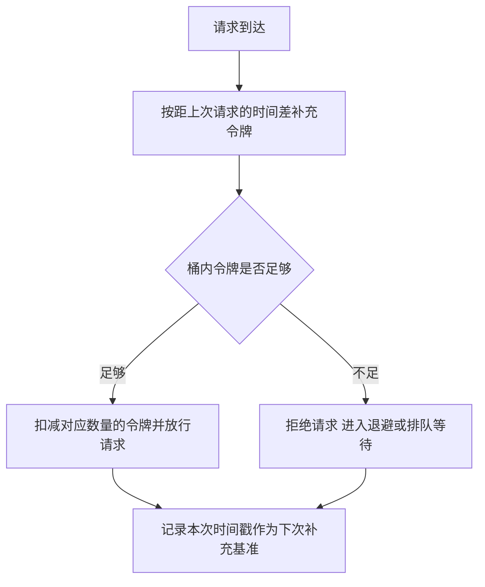

## ALG-196：批量导出场景既要允许用户瞬时点 10 个请求（突发），又要长期平均不超过每秒 5 个。令牌桶如何同时满足这两个需求？
**答**：令牌桶：桶容量 capacity 决定突发上限，按固定速率往桶里放令牌（不足则封顶）；每个请求按消耗扣令牌，扣不动才拒绝。与窗口限流的本质区别：它以"余额"而非"计数"判断，突发消耗的是历史积蓄，长期平均速率被放令牌速率钳住。实现用惰性补充——不真开定时器，每次请求按距上次的时间差补令牌。O(1)。



```javascript
function tokenBucket({ capacity = 10, refillPerSec = 5 } = {}) {
  let tokens = capacity;                   // 桶初始满额 => 允许首次突发
  let last = Date.now();
  return function allow(cost = 1) {
    const now = Date.now();
    // 惰性补充：不开定时器，按时间差补，封顶 capacity
    tokens = Math.min(capacity, tokens + ((now - last) / 1000) * refillPerSec);
    last = now;
    if (tokens >= cost) {
      tokens -= cost;                      // 扣令牌放行
      return true;
    }
    return false;                          // 余额不足：拒绝或排队
  };
}
// capacity = 突发上限，refillPerSec = 长期平均速率，两个旋钮独立可调
```
