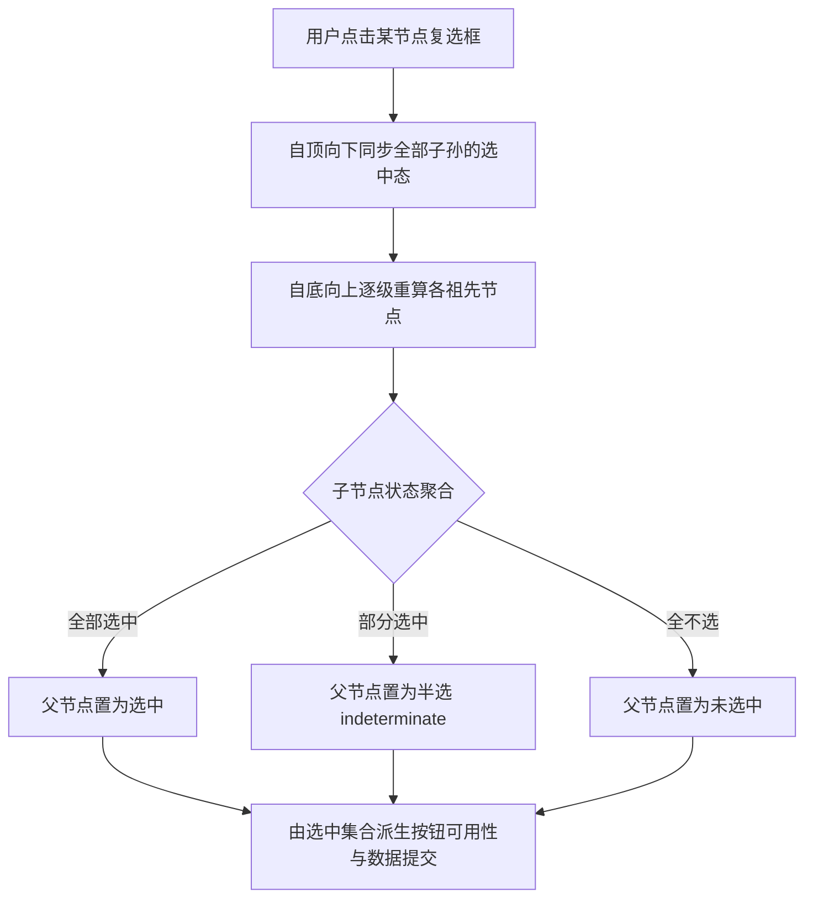

## ALG-197：权限管理页勾选某个部门后其所有子部门自动选中；勾掉一个子部门，父部门显示半选。如何实现权限树级联勾选算法？
**答**：双向传播：① 自顶向下（down）——勾选/取消某节点时递归同步所有子孙的选中态；② 自底向上（up）——由子节点状态聚合父节点：全部选中 => 选中，部分选中 => 半选（`indeterminate`，UI 态不进选中集合），全不选 => 清空。叶子节点直接映射选中集合。两次遍历 O(n)。选中集合（Set）是唯一数据源，UI 的 checked 与 indeterminate 都从它派生。



```javascript
function cascadeCheck(nodes, checkedSet) {
  // 自底向上：由子状态聚合父状态，返回 all / partial / none
  function up(node) {
    if (!node.children || !node.children.length) {  // 叶子：直接看集合
      return checkedSet.has(node.id) ? 'all' : 'none';
    }
    const states = node.children.map(up);
    const all = states.every(s => s === 'all');
    const some = states.some(s => s !== 'none');
    if (all) checkedSet.add(node.id);      // 子全选 => 父选中
    else checkedSet.delete(node.id);       // 半选/全不选 => 不进选中集合
    return all ? 'all' : some ? 'partial' : 'none';
  }
  // 自顶向下：勾父带全子，取消父清全子
  function down(node, on) {
    if (on) checkedSet.add(node.id);
    else checkedSet.delete(node.id);
    (node.children || []).forEach(c => down(c, on));
  }
  return { up: () => nodes.forEach(up), down };
}
// UI：input.indeterminate = state === 'partial'，checked 从 Set 派生
```
