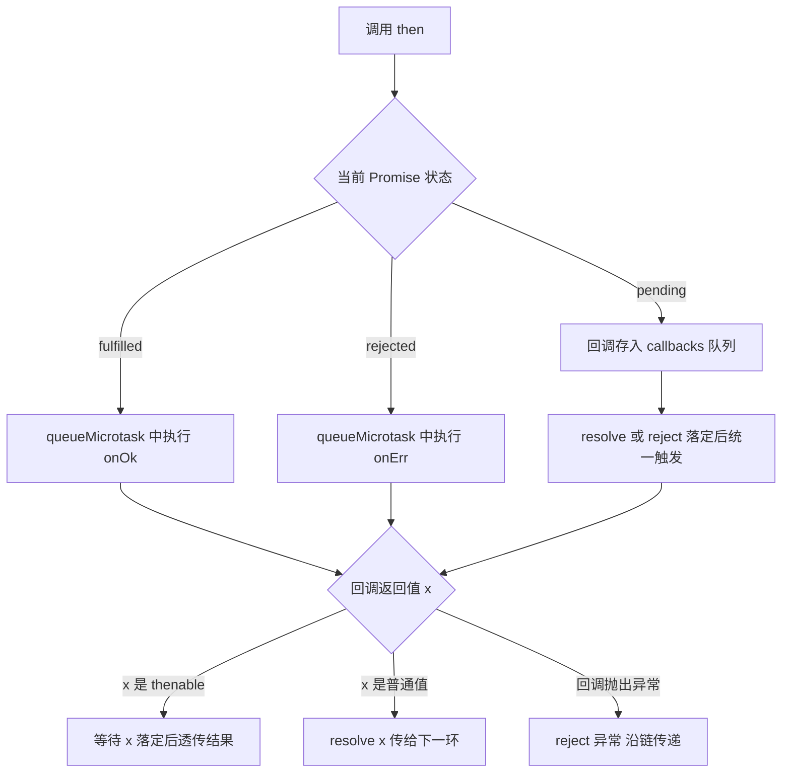

## HW-001：手写 Promise 核心（then 链）

**答**：
- 评分点：状态只能从 pending 单向流转且不可逆（fulfilled / rejected）；then 必须返回一个**新的** Promise，才能形成链式调用；回调必须异步执行（微任务 queueMicrotask），保证 then 注册时机晚于 resolve 也能收到通知；pending 时回调要存入 callbacks 队列，resolve 后统一触发；上一环返回 Promise（thenable）时要等待其落定再决定 resolve / reject；执行回调抛异常要转成 reject，实现错误沿链传递；值穿透：onFulfilled 缺省时值继续向下传，onRejected 缺省时异常继续向下抛。

```javascript
// ===== 5 分钟速写版 =====
class MyPromise {
  constructor(executor) {
    this.status = 'pending';
    this.value = undefined;
    this.callbacks = [];
    const resolve = v => {
      if (this.status !== 'pending') return;
      this.status = 'fulfilled'; this.value = v;
      this.callbacks.forEach(cb => cb.onOk());
    };
    const reject = r => {
      if (this.status !== 'pending') return;
      this.status = 'rejected'; this.value = r;
      this.callbacks.forEach(cb => cb.onErr());
    };
    try { executor(resolve, reject); } catch (e) { reject(e); }
  }
  then(onOk, onErr) {
    return new MyPromise((resolve, reject) => {
      const handle = cb => queueMicrotask(() => {
        if (typeof cb !== 'function') { // 值穿透 / 异常穿透
          this.status === 'rejected' ? reject(this.value) : resolve(this.value);
          return;
        }
        try {
          const r = cb(this.value);
          r instanceof MyPromise ? r.then(resolve, reject) : resolve(r);
        } catch (e) { reject(e); }
      });
      if (this.status === 'fulfilled') handle(onOk);
      else if (this.status === 'rejected') handle(onErr);
      else this.callbacks.push({ onOk: () => handle(onOk), onErr: () => handle(onErr) });
    });
  }
}

// ===== 标准完整版（含边界处理）=====
class MyPromise2 {
  static PENDING = 'pending';
  static FULFILLED = 'fulfilled';
  static REJECTED = 'rejected';
  constructor(executor) {
    if (typeof executor !== 'function') throw new TypeError('executor must be a function');
    this.status = MyPromise2.PENDING;
    this.value = undefined;
    this.callbacks = [];
    const resolve = v => this.settle(MyPromise2.FULFILLED, v);
    const reject = r => this.settle(MyPromise2.REJECTED, r);
    try { executor(resolve, reject); } catch (e) { reject(e); }
  }
  settle(status, value) {
    if (this.status !== MyPromise2.PENDING) return; // 状态不可逆
    this.status = status; this.value = value;
    const cbs = this.callbacks; // 先取出列表再清空，避免微任务执行时读到新空数组
    this.callbacks = [];
    queueMicrotask(() => cbs.forEach(cb => cb()));
  }
  // 解析 thenable：等待其落定，并防循环引用
  resolvePromise(p2, x, resolve, reject) {
    if (x === p2) return reject(new TypeError('Chaining cycle detected'));
    if (x !== null && (typeof x === 'object' || typeof x === 'function')) {
      let called = false;
      try {
        const then = x.then;
        if (typeof then === 'function') {
          then.call(x, y => { if (!called) { called = true; this.resolvePromise(p2, y, resolve, reject); } },
                    e => { if (!called) { called = true; reject(e); } });
        } else resolve(x);
      } catch (e) { if (!called) reject(e); }
    } else resolve(x);
  }
  then(onOk, onErr) {
    const p2 = new MyPromise2((resolve, reject) => {
      const run = cb => queueMicrotask(() => {
        if (typeof cb !== 'function') {
          this.status === MyPromise2.REJECTED ? reject(this.value) : resolve(this.value);
          return;
        }
        try { this.resolvePromise(p2, cb(this.value), resolve, reject); }
        catch (e) { reject(e); }
      });
      if (this.status === MyPromise2.FULFILLED) run(onOk);
      else if (this.status === MyPromise2.REJECTED) run(onErr);
      else this.callbacks.push(() => this.status === MyPromise2.FULFILLED ? run(onOk) : run(onErr));
    });
    return p2;
  }
  catch(onErr) { return this.then(null, onErr); }
  finally(cb) {
    return this.then(
      v => MyPromise2.resolve(cb()).then(() => v),
      e => MyPromise2.resolve(cb()).then(() => { throw e; })
    );
  }
  static resolve(v) { return v instanceof MyPromise2 ? v : new MyPromise2(r => r(v)); }
  static reject(r) { return new MyPromise2((_, rj) => rj(r)); }
}
```

then 链执行流程：



---
