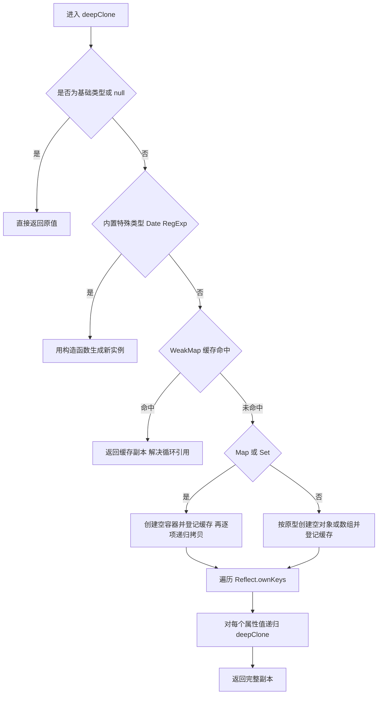

## HW-016：手写深拷贝

**答**：
- 评分点：基础类型直接返回；Date/RegExp 等内置对象要走专属构造；**循环引用**用 WeakMap 缓存已拷贝对象（WeakMap 也是高频追问点：弱引用不阻止 GC）；Map/Set 要分别按各自 API 拷贝内部键值；拷贝结果要保留原型（`Object.create(Object.getPrototypeOf(obj))`）；键遍历建议 `Reflect.ownKeys`（含 Symbol key）+ 递归拷贝属性值。

```javascript
// ===== 5 分钟速写版 =====
function deepClone(obj, map = new WeakMap()) {
  if (obj === null || typeof obj !== 'object') return obj; // 基础类型 + null
  if (obj instanceof Date) return new Date(obj);
  if (obj instanceof RegExp) return new RegExp(obj.source, obj.flags);
  if (map.has(obj)) return map.get(obj);                   // 命中缓存：解开循环引用
  const clone = Array.isArray(obj) ? [] : Object.create(Object.getPrototypeOf(obj));
  map.set(obj, clone);
  for (const key of Reflect.ownKeys(obj)) {                // 含 Symbol key
    clone[key] = deepClone(obj[key], map);
  }
  return clone;
}

// ===== 标准完整版（含边界处理）=====
function deepClonePro(obj, map = new WeakMap()) {
  if (obj === null || typeof obj !== 'object') return obj;
  if (obj instanceof Date) return new Date(obj.getTime());
  if (obj instanceof RegExp) return new RegExp(obj.source, obj.flags);
  if (obj instanceof WeakMap || obj instanceof WeakSet) {
    return new obj.constructor(); // 弱引用内容不可枚举，只能给空壳
  }
  if (map.has(obj)) return map.get(obj);
  if (obj instanceof Map) {
    const clone = new Map();
    map.set(obj, clone);
    obj.forEach((v, k) => clone.set(deepClonePro(k, map), deepClonePro(v, map)));
    return clone;
  }
  if (obj instanceof Set) {
    const clone = new Set();
    map.set(obj, clone);
    obj.forEach(v => clone.add(deepClonePro(v, map)));
    return clone;
  }
  // 保留原型（含 class 实例），而不是一律退化为普通对象/数组
  const clone = Array.isArray(obj) ? [] : Object.create(Object.getPrototypeOf(obj));
  map.set(obj, clone);
  for (const key of Reflect.ownKeys(obj)) {
    const desc = Object.getOwnPropertyDescriptor(obj, key);
    // 保留 getter/setter 语义：只拷贝 value 型描述符；访问器可按需重新绑定 getter
    if ('value' in desc) desc.value = deepClonePro(desc.value, map);
    Object.defineProperty(clone, key, desc);
  }
  return clone;
}
```

深拷贝递归流程：



---
