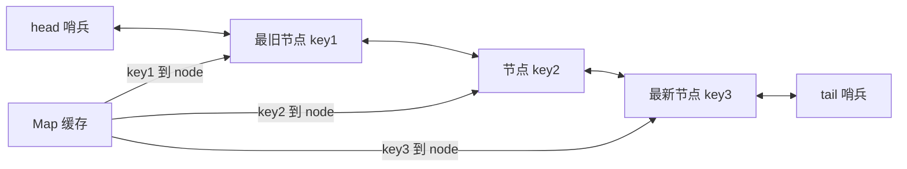

## HW-021：手写 LRU 缓存

**答**：
- 评分点：get 和 put 都要 **O(1)**——这是判题核心；Map 版利用 Map 的插入顺序：get/put 命中先 delete 再 set「移到末尾」，容量满时删 `keys().next().value`（最旧的头部）；双向链表版（LeetCode 146 满分答案）用 head/tail 哨兵节点，命中就摘下挂到尾部，淘汰删 head.next；get 不存在返回 -1（或 undefined，先说清约定）；要能画出 head ↔ tail 的双链表与 Map 中 key → node 的对应关系。

```javascript
// ===== 5 分钟速写版（Map 实现）=====
class LRUCache {
  constructor(capacity) {
    this.capacity = capacity;
    this.map = new Map();
  }
  get(key) {
    if (!this.map.has(key)) return -1;
    const val = this.map.get(key);
    this.map.delete(key);       // 删除再插入 = 移到「最新」端
    this.map.set(key, val);
    return val;
  }
  put(key, value) {
    if (this.map.has(key)) this.map.delete(key);
    else if (this.map.size >= this.capacity) {
      this.map.delete(this.map.keys().next().value); // 淘汰最旧
    }
    this.map.set(key, value);
  }
}

// ===== 标准完整版（双向链表 + Map，真 O(1)）=====
class DLinkedNode {
  constructor(key = 0, value = 0) {
    this.key = key; this.value = value;
    this.prev = null; this.next = null;
  }
}
class LRUCachePro {
  constructor(capacity) {
    if (!Number.isInteger(capacity) || capacity < 1) {
      throw new TypeError('capacity must be a positive integer');
    }
    this.capacity = capacity;
    this.map = new Map();          // key → node
    // 哨兵节点：省去边界判断
    this.head = new DLinkedNode(); // head.next 是最旧
    this.tail = new DLinkedNode(); // tail.prev 是最新
    this.head.next = this.tail;
    this.tail.prev = this.head;
  }
  _remove(node) { node.prev.next = node.next; node.next.prev = node.prev; }
  _addToTail(node) {              // 新/命中节点挂到尾部（最新端）
    node.prev = this.tail.prev;
    node.next = this.tail;
    this.tail.prev.next = node;
    this.tail.prev = node;
  }
  get(key) {
    const node = this.map.get(key);
    if (!node) return -1;
    this._remove(node);
    this._addToTail(node);        // 命中即提升为最新
    return node.value;
  }
  put(key, value) {
    const node = this.map.get(key);
    if (node) {
      node.value = value;
      this._remove(node);
      this._addToTail(node);
      return;
    }
    if (this.map.size >= this.capacity) {
      const oldest = this.head.next;    // 淘汰最旧
      this._remove(oldest);
      this.map.delete(oldest.key);      // 链表节点要带 key 才能 O(1) 删 Map
    }
    const fresh = new DLinkedNode(key, value);
    this.map.set(key, fresh);
    this._addToTail(fresh);
  }
  get size() { return this.map.size; }
}
```

LRU 双链表结构：



---
