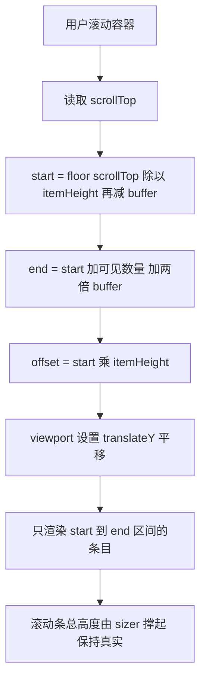

## HW-037：手写虚拟列表核心（定高）

**答**：
- 评分点：三个核心量——`start = Math.floor(scrollTop / itemHeight)`、可见数量 `Math.ceil(clientHeight / itemHeight)`（再加上下 buffer 各 N 条防白屏）、`offset = start * itemHeight`（用 transform 或 padding 撑起上方空白）；外层容器撑出**总高度** `total * itemHeight` 形成真实滚动条；滚动监听更新起止下标并重渲染**只渲染可见区**；要能说出定高与不定高的差异（不定高需要缓存测量高度 + 二分查找定位）；数据量在千级时才值得用（少量数据直接渲染更好）。

```javascript
// ===== 5 分钟速写版 =====
function virtualListCore(scrollTop, clientHeight, total, itemHeight, buffer = 5) {
  const visibleCount = Math.ceil(clientHeight / itemHeight);
  const start = Math.max(0, Math.floor(scrollTop / itemHeight) - buffer);
  const end = Math.min(total, start + visibleCount + buffer * 2);
  return { start, end, offset: start * itemHeight }; // offset 用于 transform 平移
}

// ===== 标准完整版（含边界处理）=====
class VirtualList {
  constructor({ container, itemHeight, totalCount, renderItem }) {
    if (itemHeight <= 0) throw new TypeError('itemHeight must be positive');
    this.container = container;
    this.itemHeight = itemHeight;
    this.totalCount = totalCount;
    this.renderItem = renderItem;
    this.buffer = 5;
    this.scrollTop = 0;
    container.style.overflowY = 'auto';
    container.style.position = 'relative';
    // 内层：撑出总高度，制造真实滚动条
    this.sizer = document.createElement('div');
    this.sizer.style.height = `${totalCount * itemHeight}px`;
    // 视口层：绝对定位，滚动时只平移
    this.viewport = document.createElement('div');
    this.viewport.style.position = 'absolute';
    this.viewport.style.left = '0';
    this.viewport.style.right = '0';
    this.viewport.style.top = '0';
    container.append(this.sizer, this.viewport);
    this._bindEvents();
    this._render();
  }
  _bindEvents() {
    this._onScroll = () => {
      this.scrollTop = this.container.scrollTop;
      // 同帧多次 scroll 事件只渲染一次
      if (!this._ticking) {
        this._ticking = true;
        requestAnimationFrame(() => { this._ticking = false; this._render(); });
      }
    };
    this.container.addEventListener('scroll', this._onScroll, { passive: true });
  }
  _render() {
    const visible = Math.ceil(this.container.clientHeight / this.itemHeight);
    const start = Math.max(0, Math.floor(this.scrollTop / this.itemHeight) - this.buffer);
    const end = Math.min(this.totalCount, start + visible + this.buffer * 2);
    this.viewport.style.transform = `translateY(${start * this.itemHeight}px)`;
    const frag = document.createDocumentFragment();
    for (let i = start; i < end; i++) frag.appendChild(this.renderItem(i));
    this.viewport.replaceChildren(frag); // 一次性替换，减少重排次数
  }
  updateTotal(totalCount) {              // 数据变化时同步滚动高度
    this.totalCount = totalCount;
    this.sizer.style.height = `${totalCount * this.itemHeight}px`;
    this._render();
  }
  destroy() { this.container.removeEventListener('scroll', this._onScroll); }
}
```

虚拟列表滚动定位流程：



---
## 五、框架相关必手写（HW-038 ~ HW-047）
