# 前端面试题库：场景算法（基于真实前端场景的算法考察）

> 本文件是前端面试工程算法专题，共 **200 题（ALG-001 ~ ALG-200）**，定位为"基于前端场景的算法考察"：每题先给一个真实前端场景（版本列表、权限树、虚拟列表、购物车、上传、监控、diff、缓存、手写 Promise、限流等），再考察算法功底，**不考裸 LeetCode 原题编号**。ALG-001 ~ ALG-100 为第一至十章，ALG-101 ~ ALG-200 为第十一至二十一章（位运算与数学、高频手写、函数式、设计题、复杂场景、大数据量、缓存一致性、异步调度、安全、性能度量、综合大题）。面向字节、阿里、腾讯等大厂前端面试的高频风格。

```mermaid
graph TD
    A[场景算法专题 共 200 题] --> B[数组与集合 ALG-001 到 010]
    A --> C[字符串处理 ALG-011 到 020]
    A --> D[树结构 ALG-021 到 033]
    A --> E[栈与队列 ALG-034 到 040]
    A --> F[链表 ALG-041 到 047]
    A --> G[哈希与设计 ALG-048 到 056]
    A --> H[双指针与滑动窗口 ALG-057 到 065]
    A --> I[二分与排序 ALG-066 到 073]
    A --> J[动态规划与贪心 ALG-074 到 086]
    A --> K[图与综合 ALG-087 到 100]
    A --> L[十一 位运算与数学 ALG-101 到 108]
    A --> M[十二 高频手写综合 ALG-109 到 121]
    A --> N[十三 函数式与组合 ALG-122 到 128]
    A --> O[十四 设计题 ALG-129 到 137]
    A --> P[十五 复杂场景算法 ALG-138 到 148]
    A --> Q[十六 大数据量处理 ALG-149 到 157]
    A --> R[十七 缓存与一致性 ALG-158 到 163]
    A --> S[十八 异步时序与调度 ALG-164 到 170]
    A --> T[十九 安全相关算法 ALG-171 到 176]
    A --> U[二十 性能度量算法 ALG-177 到 181]
    A --> V[二十一 综合大题 ALG-182 到 200]
```

## 目录

- 一、数组与集合（ALG-001 ~ ALG-010）
- 二、字符串处理（ALG-011 ~ ALG-020）
- 三、树结构（ALG-021 ~ ALG-033）
- 四、栈与队列（ALG-034 ~ ALG-040）
- 五、链表（ALG-041 ~ ALG-047）
- 六、哈希与设计（ALG-048 ~ ALG-056）
- 七、双指针与滑动窗口（ALG-057 ~ ALG-065）
- 八、二分与排序（ALG-066 ~ ALG-073）
- 九、动态规划与贪心（ALG-074 ~ ALG-086）
- 十、图与综合（ALG-087 ~ ALG-100）
- 十一、位运算与数学（ALG-101 ~ ALG-108）
- 十二、高频手写综合（ALG-109 ~ ALG-121）
- 十三、函数式与组合（ALG-122 ~ ALG-128）
- 十四、设计题（ALG-129 ~ ALG-137）
- 十五、复杂场景算法（ALG-138 ~ ALG-148）
- 十六、大数据量处理（ALG-149 ~ ALG-157）
- 十七、缓存与一致性（ALG-158 ~ ALG-163）
- 十八、异步时序与调度（ALG-164 ~ ALG-170）
- 十九、安全相关算法（ALG-171 ~ ALG-176）
- 二十、性能度量算法（ALG-177 ~ ALG-181）
- 二十一、综合大题（ALG-182 ~ ALG-200）

---

## 一、数组与集合

---

## ⚠️ 与「经典算法题库」的分工

本目录（`06-算法与手写`，960 题）是 **场景包装算法（ALG 550）+ 前端手写实现（HW 410）**，侧重"在前端业务场景里用算法"和"手写代码能力"。

**大厂笔试真实考察的 LeetCode 经典题不在本目录**，在：

- `../18-经典算法题库/` —— 22 个题型 / 430 题，每题含题干、暴力→最优思路、可运行代码、复杂度、易错点、变体追问。
- `../_prep/09-算法冲刺手册.md` —— 题型识别决策树、数据规模反推算法、20 个核心模板、30 天刷题计划、考场策略。
- `../18-经典算法题库/23-模拟笔试套卷.md` —— 4 套限时模拟卷（字节/阿里/腾讯/综合），含手写加试。

**优先级建议**：笔试算法 → 先刷 18 目录的 ★★★ 八型（160 题）；前端手写 → 用本目录的 HW 系列（防抖节流、Promise.all、深拷贝、EventEmitter、LRU、虚拟 DOM diff 等 20 题必手写）。
