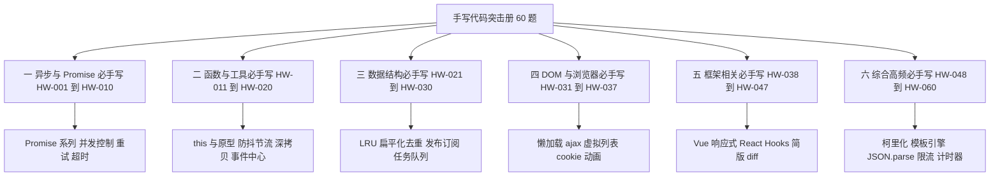

# 前端面试题库：手写代码突击册

> **定位**：大厂面试「现场手写」环节集中速练。共 60 题（HW-001 ~ HW-060），覆盖异步、函数工具、数据结构、DOM、框架原理、综合高频六大类。
>
> **使用方法（强烈建议按此执行）**：
> 1. 每题先**遮住答案**，给自己 5 分钟，在白板 / 草稿纸上写「5 分钟速写版」；
> 2. 写完对照答案，检查逻辑漏洞，再精读「标准完整版」的边界处理；
> 3. 最后逐条核对「评分点清单」——那就是面试官的目光落点；
> 4. 每章练完做一次「盲写复测」，隔 3 天再回看一遍。
>
> **三段结构**：每题 = 评分点清单 + 两个版本的代码（同一个代码围栏内，用注释分隔）：
> - **5 分钟速写版**：15~30 行，白板可写完，抓主干、保正确；
> - **标准完整版（含边界处理）**：30~60 行，展示工程素养：参数校验、边界 case、可扩展性。

## 手写题知识总览

## 目录

- [一、异步与 Promise 必手写（HW-001 ~ HW-010）](#一异步与-promise-必手写hw-001--hw-010)
- [二、函数与工具必手写（HW-011 ~ HW-020）](#二函数与工具必手写hw-011--hw-020)
- [三、数据结构必手写（HW-021 ~ HW-030）](#三数据结构必手写hw-021--hw-030)
- [四、DOM 与浏览器必手写（HW-031 ~ HW-037）](#四dom-与浏览器必手写hw-031--hw-037)
- [五、框架相关必手写（HW-038 ~ HW-047）](#五框架相关必手写hw-038--hw-047)
- [六、综合高频必手写（HW-048 ~ HW-060）](#六综合高频必手写hw-048--hw-060)

---

## 一、异步与 Promise 必手写（HW-001 ~ HW-010）

