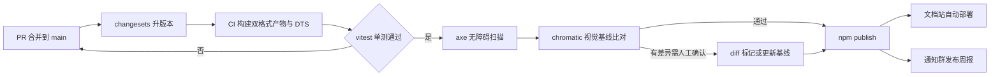

## ARC-028：组件库的整体架构如何设计（源码/构建/文档/测试/发布一条龙）？文档站如何选型？
**答**：
- 组件库是"产品"：源码 + 构建（双格式产物）+ 文档站（示例即测试）+ 测试（单测+视觉回归）+ 版本发布，五件套缺一不可。
- 文档站选型：React 生态用 Storybook（生态最大、addons 丰富、偏隔离展示）；需要带业务 Demo/MDX 深度定制用 dumi（Ant 系、中文友好）；内部组件库常选 Storybook + 自研首页。
- 目录按"一组件一目录"内聚：组件、样式、单测、文档、demo 放一起，删组件=删目录。

```text
packages/ui/
├── src/
│   └── button/
│       ├── Button.tsx          # 组件实现
│       ├── button.scss         # 样式（Token 驱动）
│       ├── Button.test.tsx     # 单测（RTL）
│       ├── button.stories.tsx  # 文档即示例（CSF3）
│       ├── button.docs.mdx     # API 说明
│       └── index.ts
├── .storybook/                 # 文档站配置（main.ts/preview.tsx）
├── vitest.config.ts            # 单测
├── chromatic.config.json       # 视觉回归
├── package.json                # exports 双格式
└── turbo.json
# 发布链路：main 合并 → changesets 定版本 → CI build(ESM+CJS+DTS)
# → vitest + axe 无障碍检查 → chromatic 视觉基线比对 → npm publish → 文档站同步部署
```


