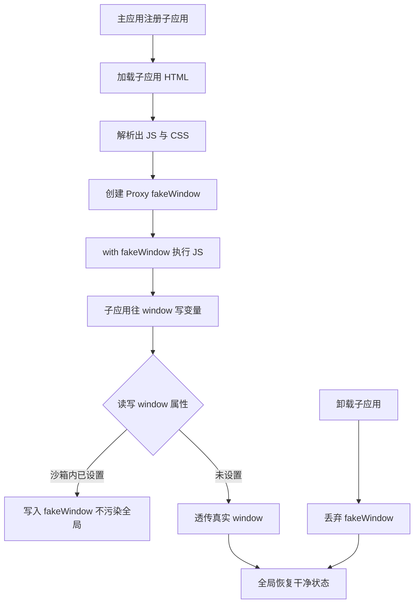

## ARC-040：qiankun 的工作原理是什么？（JS 沙箱、样式隔离、生命周期）
**答**：
- JS 沙箱：Proxy 沙箱（新浏览器）代理 window 的读写进各自 fakeWindow；降级 SnapshotSandbox 激活时拍 window 快照、卸载时恢复（legacy Safari）。
- 样式隔离：experimentalStyleIsolation 用 scoped（选择器改写）或 strictStyleIsolation 用 Shadow DOM（彻底但弹窗等挂 body 的组件失效）。
- 生命周期：loadMicroApp/singleSpa 注册后按 bootstrap → mount → unmount 驱动，unmount 时恢复被劫持的全局副作用。



```typescript
// 简化版 Proxy 沙箱核心思想
function createProxySandbox() {
  const fakeWindow: Record<PropertyKey, unknown> = {};
  let active = false;
  const proxy = new Proxy(fakeWindow, {
    get(_, key) {
      return key in fakeWindow ? fakeWindow[key] : (window as any)[key]; // 未覆写则透传
    },
    set(_, key, value) {
      if (!active) return true;             // 未激活期间禁止写全局
      fakeWindow[key] = value;              // 写入沙箱，不污染真实 window
      return true;
    },
  });
  return {
    proxy,
    mount() { active = true; },
    unmount() { active = false; /* Snapshot 降级方案在此处恢复 window 快照 */ },
  };
}
```
