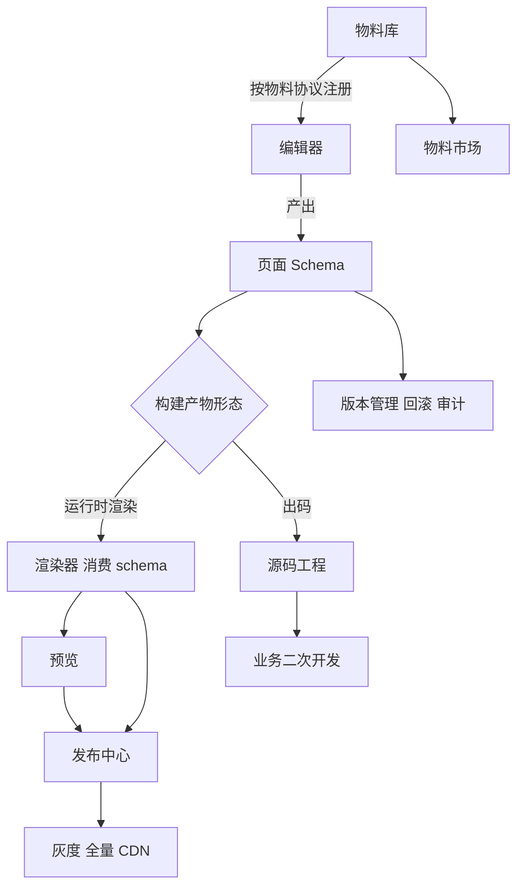

## ARC-088：低代码平台的整体架构如何设计？
**答**：
- 五大模块：编辑器（画布/属性面板/物料面板）、物料体系（组件 + 协议描述）、渲染器（schema → 页面）、出码/预览引擎、发布与托管。
- 核心是一条协议主线：物料按协议注册进编辑器，编辑器产出 schema，渲染器消费 schema，发布把 schema + 物料版本固化成应用。
- 架构铁律：编辑态与运行态共用一套渲染器（所见即所得），编辑器只是在渲染器外面包了一层选中/拖拽交互。

