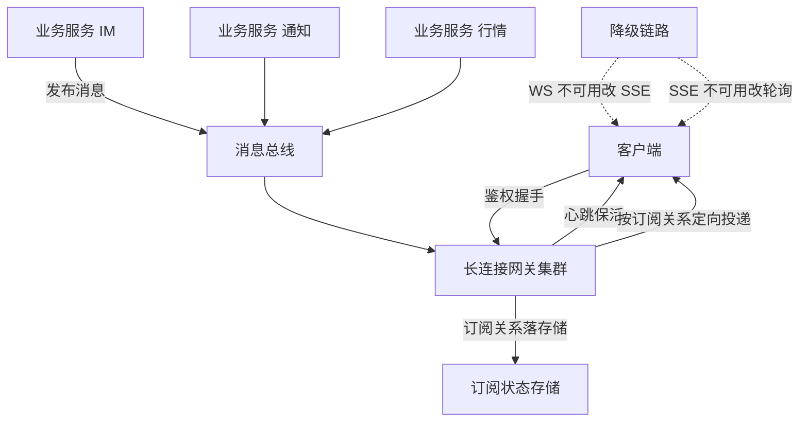

## ARC-105：推送与实时架构（轮询/SSE/WebSocket）如何选型？长连接网关怎么设计？
**答**：
- 选型矩阵：轮询（实现最简单、延迟高、无谓开销大，适合低频状态检查）；SSE（单向服务端推、文本协议、自动重连，适合通知/进度）；WebSocket（双向、低延迟，适合 IM/协作/游戏）。原则：能 SSE 不 WS，能轮询不 SSE，按业务实时性要求选而不是炫技。
- 长连接网关独立成服务：连接管理（百万连接）、鉴权、订阅/退订、心跳保活、按房间/用户广播，业务服务只发消息不持有连接。
- 降级链路必须内建：WS 连不上自动降 SSE，再降轮询，对业务透明。



```json
// 网关统一消息协议（业务无关）
{
  "type": "msg",                     // msg | ack | ping | kick | subscribe
  "topic": "im.chat.10086",
  "seq": 10241,                      // 服务端单调序号，客户端据此发现丢包
  "payload": { "from": "u_2", "body": "hello", "ts": 1730000000000 },
  "ack": 10240                       // 客户端确认收到的最大 seq
}
// 客户端策略：seq 断档立即走 HTTP 补拉接口，不依赖长连接补齐
```
