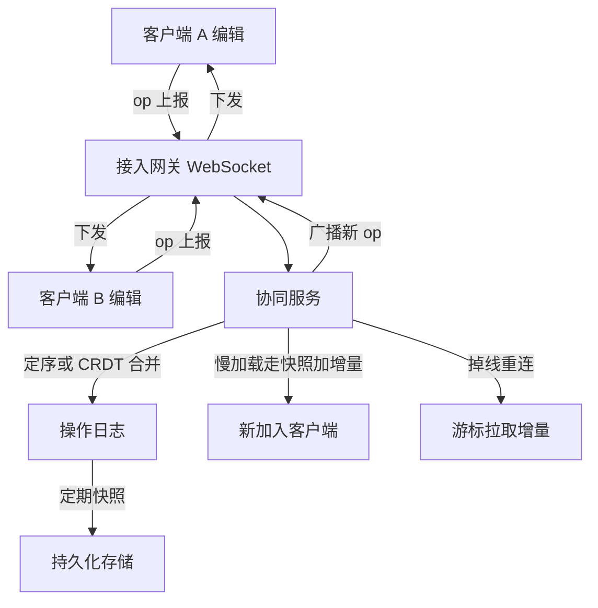

## ARC-117：在线文档协同架构概览：OT 与 CRDT 概念对比？（高频）
**答**：
- 两条技术路线：OT（Operational Transformation）把并发操作在服务端"变换"后重放，需要中心服务器定序，算法难写但成熟（Google Docs 路线）；CRDT（Conflict-free Replicated Data Type）设计天然可交换合并的数据结构，无中心也能收敛（Figma/Yjs 路线），实现简单但内存与元数据开销大。
- 协同系统组成：接入网关（长连接）、协同服务（定序/transform 或 CRDT 合并）、持久化（增量日志 + 定期快照）、广播服务。
- 架构决策要点：文本协作文档多、并发低 → OT 够用且省内存；复杂结构（白板/表格/脑图）对象嵌套深 → CRDT（如 Yjs）开发效率远高于手写 transform。
- 离线协同是 CRDT 的天然优势场景；OT 做离线需要本地完整重放，复杂度高。



```typescript
// 协同操作协议（OT 风格，CRDT 则为带 id 的原子操作）
interface DocOp {
  type: 'insert' | 'delete';
  pos: number;                 // 操作位置
  text?: string;               // insert 内容
  len?: number;                // delete 长度
  version: number;             // 基于服务端哪个版本产生
  clientId: string;
}
// 服务端定序后广播：
// { ops: DocOp[], serverVersion: 1024 }   —— 客户端收到后先 transform 再应用
// 持久化：append-only oplog（可回放任意历史版本）+ 每 5 分钟快照
// 选型小结：
// 文档纯文本协同 → OT（自研或 shareDB），省内存、成熟
// 富结构（白板/表格/嵌套） → CRDT（Yjs），开发成本低、离线友好
```
