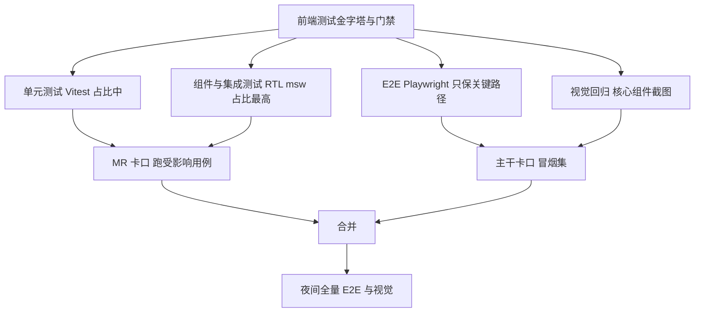

## ARC-123：测试金字塔在前端如何落地（单测/集成/E2E 比例与工具链）？
**答**：
- 经典金字塔（多单测、少集成、最少 E2E）在前端要修正为"偏奖杯形"：纯函数单测价值密度高但占比不必虚高，组件/集成测试是前端性价比最高的一层（RTL 社区主流），E2E 只覆盖关键用户路径。
- 工具链映射：单测 Vitest、组件测试 Testing Library、E2E Playwright、视觉回归 Playwright 截图或 Chromatic、mock 网络 msw。
- 分层执行策略：MR 阶段跑受影响的单测+组件测试（分钟级），E2E 只跑冒烟；主干夜间跑全量 E2E——用分层换反馈速度。
- 比例不是教条，看缺陷逃逸分布反推：线上 bug 集中在哪层，就加强哪层。



```yaml
# 测试分层执行策略（CI 消费）
test_layers:
  unit:        { tool: vitest,        trigger: affected, budget: "< 2min" }
  component:   { tool: "@testing-library/react + msw", trigger: affected, budget: "< 5min" }
  e2e_smoke:   { tool: playwright,    trigger: always,   budget: "< 8min", cases: 40 }   # 关键路径
  e2e_full:    { tool: playwright,    trigger: nightly,  cases: 500 }
  visual:      { tool: playwright-screenshot, trigger: nightly + 手动基线更新 }
ratio_guide:                 # 指导值，按缺陷逃逸率季度校正
  unit: 40%   # 纯逻辑/工具/hook
  component: 45%   # 交互行为
  e2e: 15%   # 关键路径
feedback_loop: 线上缺陷按"本可被哪层测试捕获"归因，季度调整各层投入
```
