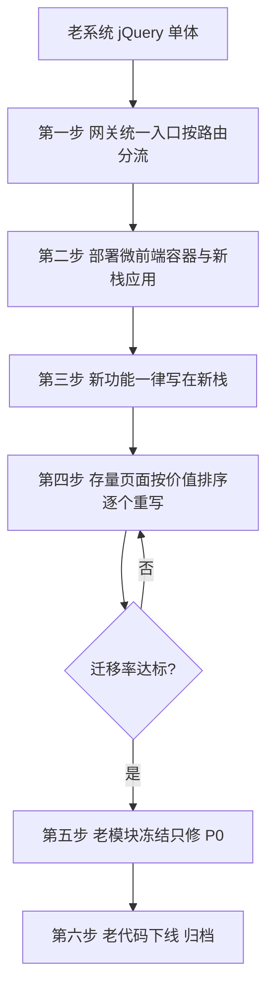

## ARC-139：jQuery 老系统渐进迁移总方案（绞杀者模式落地步骤）？
**答**：
- 绞杀者（Strangler Fig）核心思想：不重写，而是让新架构像藤蔓一样逐步包裹并最终取代老系统。落地步骤：统一入口（网关按路由分流）→ 引入新应用容器（微前端或独立域名）→ 新功能一律新栈 → 存量页面按流量/价值排序逐个重写 → 老模块冻结 → 清零下线。
- 第一优先级是"共享层打通"：登录态、公共 header、用户信息，新旧行为对用户无感知，用户感觉是同一个系统。
- 顺序策略：先迁移"高价值低风险"页面（如纯展示页）建立信心与链路，核心交易链路最后迁且配套双跑验证。
- 铁律：老系统冻结增量需求（只修 P0 bug），否则迁移永远追不上新增。



```yaml
# 网关路由分流配置（绞杀者的分流器）
gateway:
  routes:                       # 命中 rewrite_rules 的新路由 → 新应用，其余 → 老系统
    legacy_default:  http://legacy-app.internal
    modern:          http://modern-shell.internal
  rewrite_rules:
    - path: /user/profile        → modern   # 已迁移页面
    - path: /user/settings/*     → modern
    - path: /order/list          → modern
    - fallback                   → legacy   # 未迁移页面原样走老系统
  shared:
    session: 统一 SSO（新老系统互认登录态）
    layout: 公共 header/footer 由 shell 注入，视觉一致
  metrics:
    - modern_route_ratio: 已迁移路由 PV 占比（迁移率看板）
    - freeze: legacy 只允许 P0 修复类变更（流水线按分支拦截）
rollback: 任何新路由异常，网关切回 legacy 秒级恢复（路由即开关）
```
