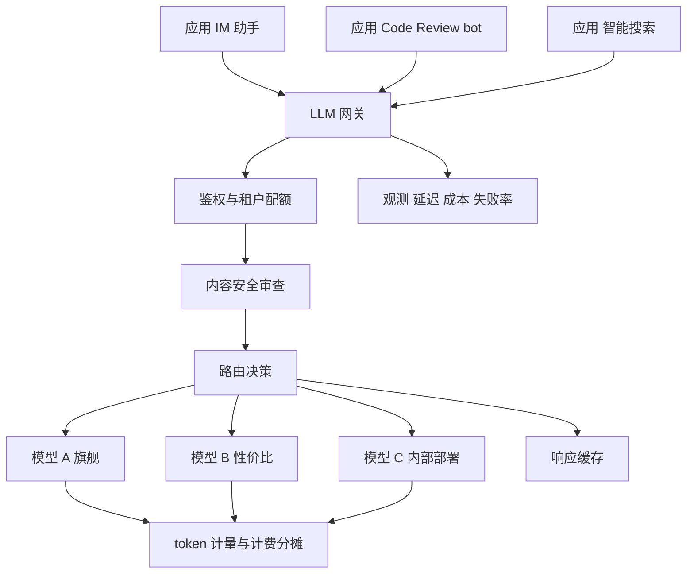

## ARC-148：LLM 网关架构（统一接入 / 多模型路由 / 限流计费）如何设计？
**答**：
- 网关职责：对上层暴露统一 API（OpenAI 兼容协议是事实标准），下层适配各厂商模型；上层应用只面向"能力"不面向"厂商"，换模型不改业务代码。
- 路由策略多维：按任务类型（代码/摘要/长文本）、按成本与质量档位、按可用性健康度自动切换、按租户配额；路由规则可配置化，支持灰度新模型。
- 平台能力内建：限流（租户级配额）、计费分摊（token 计量落账）、内容安全（输入输出双向审查）、响应缓存与重试、观测（每请求记录模型/耗时/成本）。
- 演进价值：模型价格与能力月月在变，网关让"模型选型"从架构决策变成配置决策。



```typescript
// LLM 网关统一 API 与路由配置
interface ChatRequest { model?: string; messages: Message[]; tenantId: string; budget?: TokenBudget }
interface ChatResponse { content: string; usage: { prompt: number; completion: number }; model: string; costUsd: number }

// 路由规则（yaml 配置驱动，改路由不改代码）
// routing:
//   - match: { task: code-review }            → model: qwen-coder  fallback: gpt-4o
//   - match: { task: summary, tokens < 4k }   → model: glm-flash   成本档
//   - match: { tenant: vip }                  → model: 旗舰档，优先内网部署
//   - default                                  → model: glm-flash
//   - health_check_fail → 自动切换 fallback，失败请求进降级队列
async function chat(req: ChatRequest): Promise<ChatResponse> {
  await quota.check(req.tenantId, req.budget);              // 1. 限流与配额
  const safe = await moderation.scan(req.messages);         // 2. 内容安全
  const route = router.pick(req, health.snapshot());        // 3. 多维路由
  const cached = cache.get(hash(safe, route.model));
  if (cached) return cached;                                // 4. 缓存
  const res = await provider(route.model).complete(safe, { timeout: 60s, retries: 2 });
  const result = { ...res, costUsd: pricing(route.model, res.usage) };
  billing.record(req.tenantId, result);                     // 5. 计量落账
  cache.set(hash(safe, route.model), result);
  return result;
}
```
