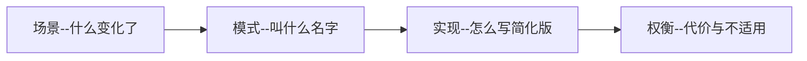

## DP-001：为什么前端需要设计模式？"框架源码即模式库"怎么理解？
**答**：
- 前端业务变化的本质是 UI 和交互的高频变更，设计模式的目标正是"封装变化点"，让改动能被局部化。
- 主流框架源码就是模式库：Vue3 响应式是代理模式 + 观察者，React 调度器是优先级队列，redux 是观察者 + 中间件职责链，axios 是适配器 + 拦截器链。
- 读源码时"用模式做索引"能极大降低理解成本，这是面试官考察设计模式的真实动机。
- 答题框架四步：场景 → 模式 → 实现 → 权衡（见下图），任何模式题都按这个骨架展开。



```javascript
// 框架源码即模式库：一个表格看懂"模式 → 框架对应物"
const patternMap = {
  单例:   'Vuex/Pinia store、全局事件总线、ES Module 导出对象',
  工厂:   'React.createElement、Vue h 函数、动态表单 schema 渲染',
  代理:   'Vue3 reactivity 的 Proxy、图片懒加载、微前端沙箱',
  观察者: 'Vue 的 dep-subscriber、redux subscribe、DOM 事件',
  职责链: 'Koa/Express 中间件、axios interceptors、tapable',
  装饰器: 'React HOC、ES 装饰器语法、AOP 埋点织入',
  策略:   '表单校验规则集、路由匹配、diff 算法分派',
  组合:   'React/Vue 组件树、文件目录渲染',
};
// 面试时能随口对上 3 个以上，就跨过了"背概念"这一档
console.log(patternMap['代理']); // Vue3 reactivity 的 Proxy、图片懒加载、微前端沙箱
```

## 追问（补充）

**追问**：

1. 三个人以内的小团队还需要这么强调设计模式吗？→ 只在变化点已经重复出现两次以上时才抽象，否则直接用框架自带机制，不为想象出来的扩展点预埋成本。
2. 都说模式能降低改动成本，你怎么度量？→ 看同一需求改动的文件数与回归范围，而不是看代码里出现了几个模式名。
3. 什么情况下不该用模式？→ 需求还在探索、只有唯一实现且短期不会变时，直接写具体代码更省事，抽象成本大于收益。
