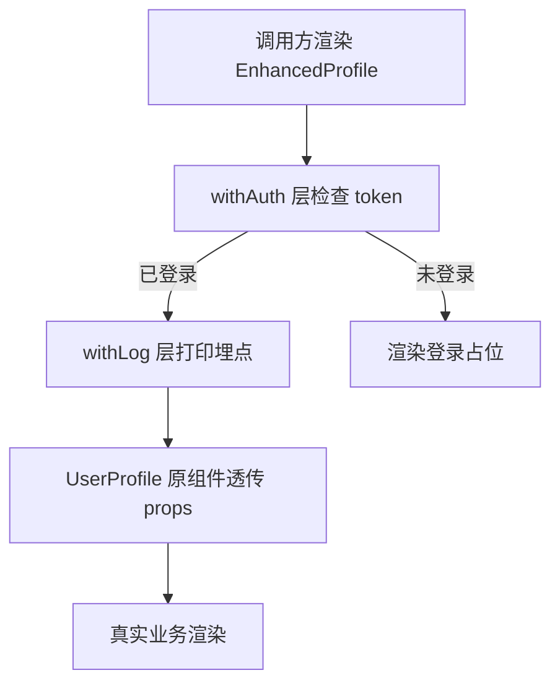

## DP-028：为什么说高阶组件 HOC 就是装饰器模式？（高频压轴）
**答**：
- 装饰器：不改变原组件接口、透明地叠加职责；HOC 接收组件返回新组件，props 协议保持兼容，正是装饰器语义。
- 对比继承：装饰器通过"包一层"扩展，避免类继承的强耦合；HOC 可以叠加多个（`compose(withAuth, withLog)(Base)`）。
- 源码对应：`React.memo`、`connect(mapStateToProps)(Component)`、`withRouter` 都是 HOC 装饰器。
- 注意代价：props 透传必须 `...this.props` 透传，否则会"吞 props"；多层包装带来调试层级加深。

```jsx
// 基础组件：职责单一
function UserProfile({ userId }) {
  const [user, setUser] = React.useState(null);
  React.useEffect(() => { fetch(`/api/users/${userId}`).then((r) => r.json()).then(setUser); }, [userId]);
  return <div>{user ? user.name : '加载中'}</div>;
}

// 装饰器1：日志增强 —— 同接口包装，透传所有 props（装饰器核心要求）
function withLog(Wrapped) {
  return function WithLog(props) {
    React.useEffect(() => { console.log('mount', Wrapped.name, props); }, []);
    return <Wrapped {...props} />; // 透传：不吞 props
  };
}

// 装饰器2：权限增强 —— 未登录渲染占位
function withAuth(Wrapped) {
  return function WithAuth(props) {
    const isLogin = Boolean(localStorage.getItem('token'));
    return isLogin ? <Wrapped {...props} /> : <div>请先登录</div>;
  };
}

// 组合装饰：像洋葱一样层层包装
const enhance = (Wrapped) => withAuth(withLog(Wrapped));
const EnhancedProfile = enhance(UserProfile);
// 渲染顺序：withAuth(外) -> withLog(中) -> UserProfile(内)

// redux 源码中的同款（对照）：compose 将多个 HOC 从右向左合成
const compose = (...fns) => (fns.length === 0 ? (x) => x : fns.reduce((a, b) => (...args) => a(b(...args))));
const Final = compose(withAuth, withLog)(UserProfile);
console.log(typeof Final); // function —— 仍是组件，接口不变
```

HOC 装饰器包装结构：


