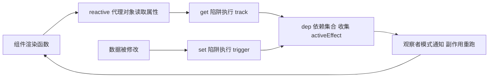

## DP-033：Vue3 响应式为什么是代理模式？（高频）
**答**：
- `reactive()` 用 Proxy 包装对象：`get` 陷阱做依赖收集（track），`set` 陷阱做派发更新（trigger）——拦截访问，正是代理模式。
- 相比 Vue2 的 `Object.defineProperty`：Proxy 能拦截新增/删除属性、数组索引、`in`/`delete`，且惰性代理嵌套对象（访问时才深层代理，性能更好）。
- 模式组合：代理模式（拦截）+ 观察者模式（dep-subscriber 通知）+ 工厂（`reactive/ref/computed` 各自创建响应式产物）。
- 加分：能对照写出 mini-reactive 的 track/trigger 骨架。

```javascript
// mini 响应式：代理模式（拦截）+ 观察者模式（收集与通知）
let activeEffect = null;
const targetMap = new WeakMap(); // target -> Map<key, Set<fn>>

function track(target, key) {
  if (!activeEffect) return;
  let depsMap = targetMap.get(target);
  if (!depsMap) targetMap.set(target, (depsMap = new Map()));
  let deps = depsMap.get(key);
  if (!deps) depsMap.set(key, (deps = new Set()));
  deps.add(activeEffect); // 依赖收集
}
function trigger(target, key) {
  (targetMap.get(target)?.get(key) || []).forEach((fn) => fn()); // 派发更新
}
function reactive(obj) {
  return new Proxy(obj, {
    get(target, key, receiver) {
      track(target, key);                       // 陷阱1：读时收集
      const val = Reflect.get(target, key, receiver);
      return typeof val === 'object' && val !== null ? reactive(val) : val; // 惰性深层代理
    },
    set(target, key, value, receiver) {
      const old = target[key];
      const ok = Reflect.set(target, key, value, receiver);
      if (old !== value) trigger(target, key);  // 陷阱2：写时派发
      return ok;
    },
    deleteProperty(target, key) {               // defineProperty 做不到的：删属性也响应
      const ok = Reflect.deleteProperty(target, key);
      trigger(target, key);
      return ok;
    },
  });
}
// 使用：effect 自动追踪依赖
function effect(fn) {
  activeEffect = fn;
  fn();
  activeEffect = null;
}
const state = reactive({ count: 0, list: [1] });
effect(() => console.log('render, count =', state.count));
state.count = 1; // render, count = 1 —— 自动重跑
state.count = 2; // render, count = 2
```

Vue3 响应式的模式组合：


