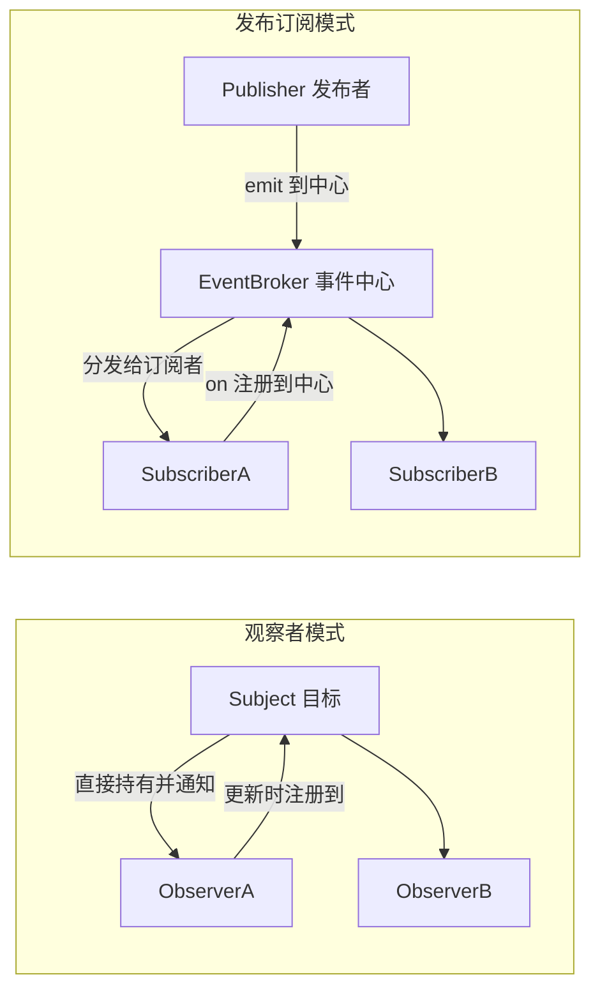

## DP-043：观察者模式和发布订阅模式的本质区别？（高频压轴）
**答**：
- 观察者：目标（Subject）直接维护观察者列表并通知，双方**知道彼此**，耦合是"松但存在"。
- 发布订阅：多了一个**事件中心（Broker）**，发布者和订阅者互不相识，解耦更彻底。
- 判别法：看有没有中间调度者——`subject.notify()` 直通是观察者；`emit/on` 经事件中心是发布订阅。
- 典型对应：Vue 的 dep→watcher 是观察者；Node EventEmitter、mitt、DOM 自定义事件是发布订阅。



```javascript
// 观察者：Subject 直接管理 Observer（双方相识）
class Subject {
  constructor() { this.observers = []; }
  addObserver(o) { this.observers.push(o); }        // 观察者注册进目标
  removeObserver(o) { this.observers = this.observers.filter((x) => x !== o); }
  notify(data) { this.observers.forEach((o) => o.update(data)); } // 目标直接通知
}
class Observer {
  constructor(name) { this.name = name; }
  update(data) { console.log(`${this.name} 收到`, data); }
}
const s = new Subject();
s.addObserver(new Observer('图表'));
s.notify({ price: 99 }); // 图表 收到 {price: 99}

// 发布订阅：事件中心居中，双方互不相识
class Broker {
  #map = new Map();
  on(event, fn) {
    if (!this.#map.has(event)) this.#map.set(event, new Set());
    this.#map.get(event).add(fn);
    return () => this.#map.get(event)?.delete(fn);
  }
  emit(event, payload) { (this.#map.get(event) || []).forEach((fn) => fn(payload)); }
}
const bus = new Broker();
const off = bus.on('price:change', (d) => console.log('订阅者1', d));
bus.on('price:change', (d) => console.log('订阅者2', d));
bus.emit('price:change', { price: 100 }); // 订阅者1 {price:100} 订阅者2 {price:100}
off(); // 订阅者1 退订后不再收到
bus.emit('price:change', { price: 101 }); // 只有 订阅者2 收到
// 本质区别：Subject.notify vs Broker.emit —— 有没有中间人
```
