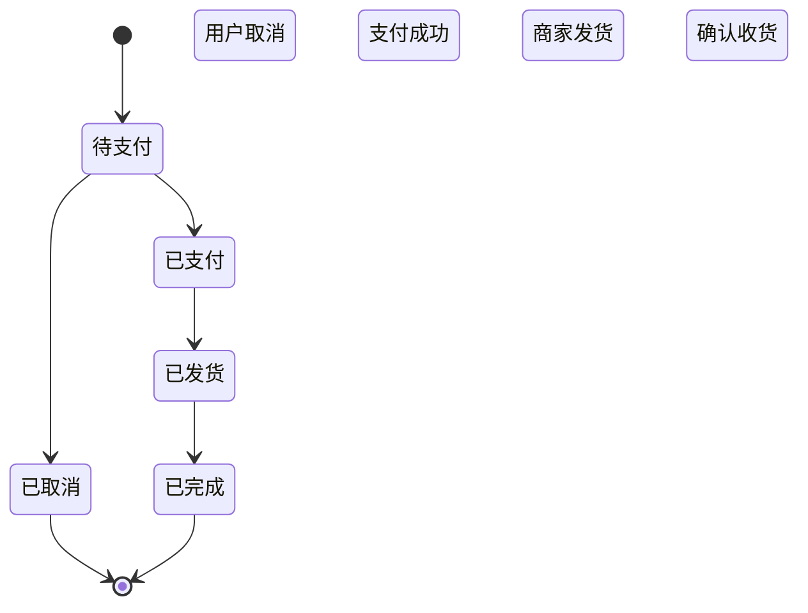

## DP-052：状态模式：订单状态机如何实现？（高频压轴）
**答**：
- 状态：对象行为随内部状态改变，每种状态封装成一个类/对象，状态切换由状态自己决定（或由上下文决定）。
- 对比 if-else：状态多、转移复杂时，if-else 的"当前态 + 事件"二维分支会爆炸；状态机把每个状态的处理内聚。
- 核心要素：状态集、事件集、转移表（state × event → next + action）、非法转移的拒绝。
- 前端实例：订单流转、播放器状态、上传队列、按钮加载态、xstate。

订单状态机示意：



```javascript
// 状态机：转移表驱动（策略模式的特化：策略=状态）
const transitions = {
  pending:   { pay: 'paid', cancel: 'cancelled' },
  paid:      { ship: 'shipped' },
  shipped:   { confirm: 'completed' },
  cancelled: {},
  completed: {},
};
class Order {
  #state = 'pending';
  #log = [];
  get state() { return this.#state; }
  send(event, payload) {                    // 统一事件入口
    const next = transitions[this.#state]?.[event];
    if (!next) throw new Error(`非法转移 ${this.#state} --${event}--> ?`);
    this.#log.push({ from: this.#state, event, to: next, payload, at: Date.now() });
    this.#state = next;
    this.#onEnter(next, payload);           // 进入新状态的副作用
    return this;
  }
  #onEnter(state, payload) {
    const effects = {
      paid: () => console.log('扣库存、发通知', payload),
      shipped: () => console.log('推送物流单号'),
    };
    effects[state]?.();
  }
  history() { return this.#log; }
}
const order = new Order();
order.send('pay', { channel: 'wx' });   // 扣库存、发通知 {channel: 'wx'}
order.send('ship');
console.log(order.state);               // shipped
try { order.send('pay'); } catch (e) { console.log(e.message); } // 非法转移 shipped --pay--> ?
```
