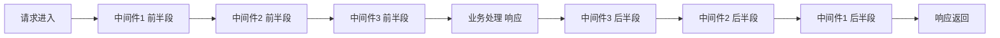

## DP-062：Koa 中间件为什么是职责链（洋葱模型）？（高频压轴）
**答**：
- 职责链：多个处理者串成链，请求沿链传递，每个节点处理后决定是否交给下一个（`next()`）。
- Koa 的 `compose` 把 `[fn1, fn2, fn3]` 合成一层嵌套 Promise：进入顺序 fn1→fn2→fn3，返回顺序 fn3→fn2→fn1（洋葱）。
- 与 Express 线性中间件的区别：Koa 支持 await next() 之后的"回程逻辑"（计时器、响应后埋点）。
- 手写 `compose` 是大厂高频手写题，核心是递归 + Promise。



```javascript
// 手写 koa-compose：职责链 + 洋葱模型
function compose(middlewares) {
  return function (ctx) {
    function dispatch(i) {
      if (i >= middlewares.length) return Promise.resolve(); // 链尾
      const mw = middlewares[i];
      return Promise.resolve(mw(ctx, () => dispatch(i + 1))); // next = 递归下一环
    }
    return dispatch(0);
  };
}
// 使用：计时中间件（回程逻辑的典型价值）
const app = {};
const middlewares = [
  async (ctx, next) => {                      // 中间件1
    const start = Date.now();
    await next();                              // 进入下一环，回程后继续执行
    ctx.cost = Date.now() - start;             // 后半段：此时业务已处理完
    console.log(`${ctx.url} 耗时 ${ctx.cost}ms`);
  },
  async (ctx, next) => {                      // 中间件2：鉴权拦截
    if (!ctx.headers?.token) throw new Error('401');
    await next();
  },
  async (ctx) => {                            // 中间件3：业务终点
    ctx.body = `hello ${ctx.url}`;
  },
];
compose(middlewares)({ url: '/api/a', headers: { token: 'x' } })
  .then(() => console.log('done'));
// hello /api/a 由中间件3写入，中间件1 再打耗时 —— 一进一回两段逻辑
// 失败传播：任一环抛错，Promise 链直接 reject，可在最外层统一兜底
compose(middlewares)({ url: '/api/b', headers: {} }).catch((e) => console.log('统一错误处理', e.message));
```
