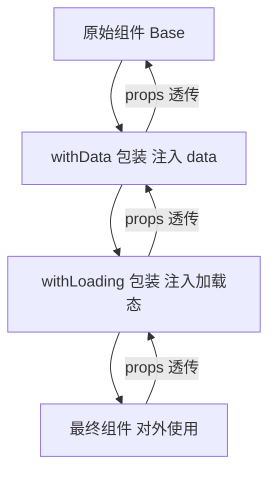

## DP-069：高阶函数与高阶组件的模式本质是什么？
**答**：
- 高阶函数：接收函数返回函数（map/compose/中间件）；高阶组件：接收组件返回组件——组件即"函数化的对象"，HOC 是高阶函数在组件层的应用。
- 模式归属：HOC 是装饰器（透明增强）、也有工厂色彩（生产新组件）；高阶函数支撑策略（回调注入）、职责链（compose）。
- 纯函数约束：HOC 不应修改传入组件（无副作用包装），返回的新组件保持 props 协议兼容。
- 辨析：自定义 Hook 是"逻辑复用"，HOC 是"组件包装增强"，render props 是"渲染权移交"——三者并列为 React 复用三件套。

```jsx
// 高阶函数：一切的基础
const trace = (label) => (fn) => (...args) => {          // 接收fn返回fn
  console.log(`[${label}] 入参`, args);
  const r = fn(...args);
  console.log(`[${label}] 出参`, r);
  return r;
};
const add = (a, b) => a + b;
console.log(trace('math')(add)(1, 2)); // [math] 入参 [1,2] 3 [math] 出参 3

// 高阶组件 = 高阶函数，包装对象是组件
function withLoading(Wrapped) {           // 装饰器模式：透明增强
  return function WithLoading({ loading, ...rest }) {
    if (loading) return <div className="spinner" />;
    return <Wrapped {...rest} />;         // 协议兼容：透传剩余 props
  };
}
function withData(fetcher) {              // 带参 HOC：工厂 + 装饰器
  return (Wrapped) => function WithData(props) {
    const [data, setData] = React.useState(null);
    React.useEffect(() => { fetcher(props).then(setData); }, []);
    return <Wrapped data={data} {...props} />;
  };
}
// 组合：先取数再装饰 loading 态
const UserList = withData(({ page }) => fetch(`/api/users?page=${page}`).then((r) => r.json()))(
  ({ data }) => <ul>{data?.map((u) => <li key={u.id}>{u.name}</li>)}</ul>
);
const EnhancedUserList = withLoading(UserList);
// <EnhancedUserList loading={true} page={1} /> —— 层层包装，各自职责单一
```

HOC 包装流程：


