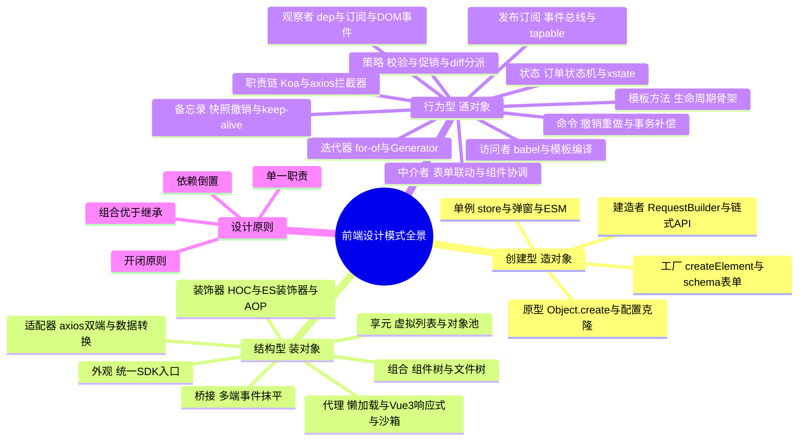

## DP-100：综合设计题：从 0 用设计模式设计一个 SDK？并收束整个模式知识体系。（高频压轴）
**答**：
- 设计题答题框架：先列需求与变化点 → 为每个变化点选模式 → 画出分层 → 说明权衡与不做的过度设计。
- 变化点→模式：多环境（适配器）、初始化配置（options/建造者）、埋点/日志切面（AOP/装饰器）、批量上报（享元/对象池）、错误捕获（观察者/代理）、插件扩展（职责链/发布订阅）、单例容器（模块单例 + 可注入兜底）。
- 权衡：不引入 IoC 容器（体量不值）、不预设抽象层（YAGNI）；核心思想是"为现在会变的方向建模"。
- 收束：三大类 × 前端场景全景图见下方 mindmap，建议对照目录逐章回刷。

```javascript
// SDK 设计蓝图：把 100 题的模式串成一条线
class TrackerSDK {
  #config; #queue = []; #plugins = []; #started = false;
  // 模式1 options 合并（DP-023）+ 模式2 模块单例兜底 + 依赖注入兜底（DP-012）
  constructor(options = {}, deps = {}) {
    this.#config = {
      appId: options.appId,
      endpoint: options.endpoint ?? '/collect',
      sampleRate: options.sampleRate ?? 1,          // 策略：采样率（DP-051）
      flushInterval: options.flushInterval ?? 5000,
      adapter: deps.transport ?? defaultTransport,  // 适配器注入（DP-026）：可换 beacon/xhr/mock
    };
  }
  use(plugin) { this.#plugins.push(plugin); return this; }   // 职责链/插件（DP-096）
  // 模式3 AOP 织入：track 前后挂切面（DP-030）
  track(event, props = {}) {
    if (this.#beforeSample(event) === false) return;         // 切面：采样策略短路
    const payload = this.#plugins.reduce(                    // 职责链：逐插件加工
      (p, fn) => fn(p) ?? p, { event, props, ts: Date.now(), appId: this.#config.appId }
    );
    this.#queue.push(payload);                               // 享元：攒批合并（DP-038）
    if (this.#queue.length >= 10) this.flush();
  }
  trackPageView = (() => {                                   // 模式4 装饰器语义化 API
    const base = function (sdk, path) { sdk.track('pv', { path }); };
    return base;
  })();
  #beforeSample(event) { return Math.random() < this.#config.sampleRate || event === 'error'; }
  flush() {
    if (!this.#queue.length) return;
    const batch = this.#queue.splice(0);                     // 备忘录语义：清空即快照提交
    this.#config.adapter(this.#config.endpoint, batch).catch(() => this.#queue.unshift(...batch)); // 失败回补
  }
  autoCatch() {                                              // 观察者：全局异常订阅（DP-047）
    window.addEventListener('error', (e) => this.track('error', { msg: e.message }));
    window.addEventListener('unhandledrejection', (e) => this.track('error', { msg: String(e.reason) }));
    return this;
  }
}
async function defaultTransport(url, data) {                 // 适配器实现：beacon 优先
  if (navigator.sendBeacon) navigator.sendBeacon(url, JSON.stringify(data));
  else await fetch(url, { method: 'POST', body: JSON.stringify(data) });
}
// 模式5 单例出口（DP-009）：模块级唯一实例
export const tracker = new TrackerSDK({ appId: 'demo' }, {})
  .use((p) => ({ ...p, env: 'prod' }))                       // 插件：附加公共字段
  .autoCatch();
// tracker.track('click', { btn: 'pay' }) —— 一个 SDK，五类模式各就各位
console.log('SDK 设计完成：适配器/策略/职责链/享元/观察者/单例/AOP');
```

三大类 × 前端场景全景收束：



---

> **DP-001 ~ DP-100 完**。DP-101 ~ DP-200（业务重构实战与模式组合）见下文第十二 ~ 二十一章。


---

## 十二、重构实战：从坏代码到模式
