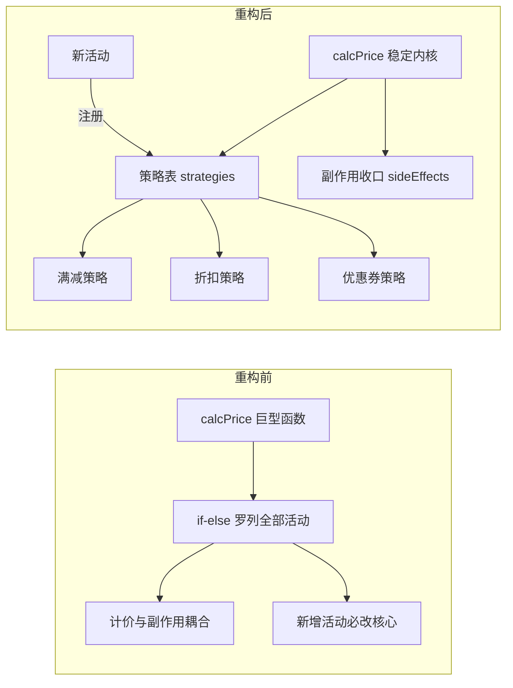

## DP-101：重构实战：满屏 if-else 的促销计算器如何一步步升级为策略模式？（高频压轴）
**答**：
- 重构路线：先写测试锁定现有行为 → 提取"规则 = 名称 + 计算函数"的统一形状 → if-else 每个分支搬进策略表 → 核心只留"查表 + 归约"。
- 收益：新增活动只注册新策略（OCP），计价核心不再被修改；每个策略可独立单测；计价与副作用（发赠品、打标）分离。
- 边界：只有两三个稳定分支时不必上策略，避免过度设计（DP-007）；分支会持续膨胀才是信号。

```javascript
// 重构前：每上一个新活动都来改这个函数，测试全量回归
function calcPrice(price, type, payload) {
  if (type === 'full') {                    // 满 300 减 40
    return price >= 300 ? price - 40 : price;
  } else if (type === 'percent') {          // 打 8 折
    return price * payload.rate;
  } else if (type === 'coupon') {           // 优惠券抵扣
    return Math.max(0, price - payload.amount);
  } else if (type === 'gift') {             // 赠品：副作用混进了计价
    addGift(payload.skuId);
    return price;
  }
  return price;
}
```

```javascript
// 重构后：策略表 + 稳定内核；gift 改为管道上的副作用装饰器
const strategies = {
  full:    (p, { full, cut }) => (p >= full ? p - cut : p),
  percent: (p, { rate }) => p * rate,
  coupon:  (p, { amount }) => Math.max(0, p - amount),
};
const sideEffects = {                       // 不改价的规则单独收口
  gift: (ctx, { skuId }) => ctx.gifts.push(skuId),
};
function calcPrice(ctx, rules) {            // ctx = { price, gifts }
  return rules.reduce((p, r) => {
    const calc = strategies[r.type];
    if (calc) return calc(p, r.payload);    // 纯计价
    if (sideEffects[r.type]) sideEffects[r.type](ctx, r.payload);  // 纯副作用
    throw new Error('未知促销规则 ' + r.type);   // fail fast
  }, ctx.price);
}
const ctx = { price: 400, gifts: [] };
const final = calcPrice(ctx, [
  { type: 'percent', payload: { rate: 0.8 } },
  { type: 'gift',    payload: { skuId: 'A1' } },
]);
console.log(final, ctx.gifts);              // 320 [ 'A1' ]
```

重构前后对比图：


