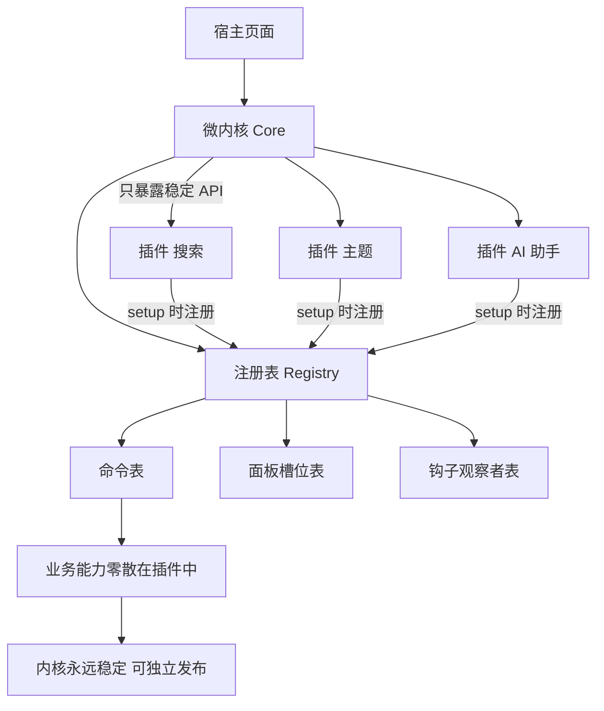

## DP-139：什么是微内核模式？如何设计一个插件化的 UI 系统？（高频压轴）
**答**：
- 微内核 = 最小稳定内核（调度、生命周期、注册表）+ 一切能力皆插件（面板、命令、主题）；内核不 import 任何插件，插件只依赖内核公开的 API（依赖倒置）。
- 三要素：ExtensionPoint（扩展点声明）、Plugin（注册扩展）、Registry（内核登记与查询）；tapable/webpack、VSCode、低代码引擎同构（DP-096）。
- 边界：只有"生态要长"的系统值得微内核；页面级应用硬拆微内核就是过度设计（DP-007）。

```javascript
// 内核：只有注册表 + 生命周期调度，无任何业务能力
class UICore {
  #plugins = []; #commands = new Map(); #panels = new Map(); #hooks = new Map();   // 扩展点登记表
  use(plugin) { this.#plugins.push(plugin); plugin.setup(this.api); return this; }  // 插件入口
  api = {
    registerCommand: (name, handler) => this.#commands.set(name, handler),          // 扩展点1 命令
    registerPanel: (slot, comp) => { (this.#panels.get(slot) ?? this.#panels.set(slot, []).get(slot)).push(comp); }, // 扩展点2 面板
    on: (hook, fn) => { (this.#hooks.get(hook) ?? this.#hooks.set(hook, []).get(hook)).push(fn); },  // 扩展点3 钩子观察者
    emit: (hook, payload) => this.#hooks.get(hook)?.reduce((p, f) => f(p), payload), // 钩子链
  };
  runCommand(name, payload) {
    const handler = this.#commands.get(name);
    if (!handler) throw new Error('命令未注册 ' + name);
    this.api.emit('before-command', { name, payload });      // 内核只做调度，不做业务
    return handler(payload);
  }
  renderSlot(slot) { return this.#panels.get(slot) ?? []; }  // 渲染时查表
}
// 插件A：搜索能力（内核不知道"搜索"是什么）
const searchPlugin = { setup: (api) => {
  api.registerCommand('search', (kw) => console.log('搜索', kw));
  api.registerPanel('toolbar', 'SearchBox');
  api.on('before-command', (p) => ({ ...p, ts: Date.now() }));  // 插件织入日志（AOP）
}};
// 插件B：主题能力，独立注册互不感知
const themePlugin = { setup: (api) => api.registerPanel('sidebar', 'ThemePanel') };
new UICore().use(searchPlugin).use(themePlugin).runCommand('search', 'hooks');
```

微内核架构图：


