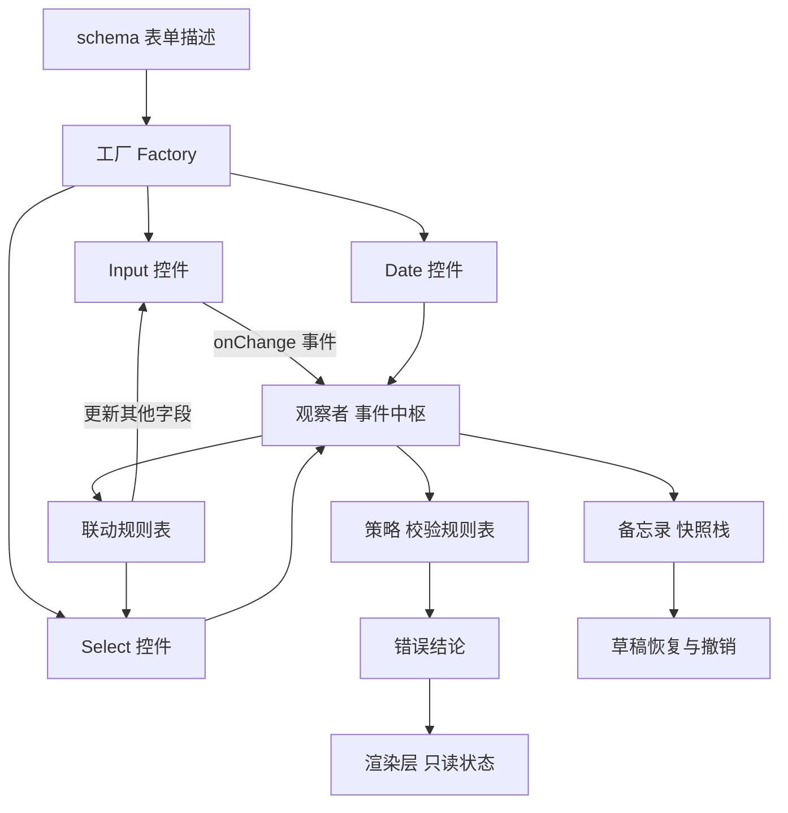

## DP-145：表单引擎由哪些模式组合而成？（工厂+策略+观察者+备忘录 压轴）
**答**：
- 四模式分工：工厂按 schema 字段类型创建控件（DP-018）；策略承载校验与联动规则（DP-051）；观察者实现字段间联动广播（DP-043）；备忘录保存草稿与历史快照（DP-067）。
- 数据流：schema → 工厂实例化控件 → 控件变更发出事件 → 联动引擎（观察者）按规则更新其他字段 → 校验引擎（策略）出结论 → 备忘录存档。
- 收束：一个字段四条链路各归其位，任何扩展（新控件、新规则、新联动）都只加策略/注册，引擎不动。

```javascript
// 表单引擎骨架：四种模式各就各位
class FormEngine {
  #fields = new Map(); #rules = new Map(); #linkages = []; #history = [];   // 工厂产品 / 策略表 / 观察者 / 备忘录
  registerControl(type, ControlClass) { this.#fields.set(type, ControlClass); }   // 工厂注册（控件目录）
  registerRule(name, fn) { this.#rules.set(name, fn); }                          // 策略注册（校验规则）
  addLinkage(watch, effect) { this.#linkages.push({ watch, effect }); }          // 联动规则（观察者订阅表）
  createField(schema) {
    const Cls = this.#fields.get(schema.type);
    if (!Cls) throw new Error('未注册控件 ' + schema.type);
    const field = new Cls(schema);                        // 工厂产出控件实例
    field.onChange = (value) => {                         // 观察者：变更 → 联动 → 校验 → 存档
      const prev = { ...field.value };                    // 备忘录：改动前快照
      field.value = value;
      this.#linkages.filter((l) => l.watch === schema.name).forEach((l) => l.effect(value, this));
      field.errors = (schema.rules ?? []).map((r) => this.#rules.get(r)(value)).filter((m) => m !== true);
      this.#history.push({ name: schema.name, prev, next: value });
      this.emit('change', this.getValues());              // 引擎对外广播（表单级观察者）
    };
    return field;
  }
  emit = null; getValues = null;                          // 由宿主注入（观察者出口）
}
// 装配示例：注册 → 建 schema → 实例化
const engine = new FormEngine();
engine.registerControl('input', InputControl);
engine.registerControl('select', SelectControl);
engine.registerRule('required', (v) => (v !== '' && v != null) || '必填');
engine.registerRule('phone', (v) => !v || /^1[3-9]\d{9}$/.test(v) || '手机号错误');
engine.addLinkage('city', (v, e) => v === 'other' && e.createField({ name: 'otherCity', type: 'input', rules: ['required'] }));
engine.emit = (t, p) => console.log(t, p); engine.getValues = () => ({});  // 宿主注入示意
engine.createField({ name: 'phone', type: 'input', rules: ['required', 'phone'] });
```

表单引擎模式组合图：



---

## 十八、基础设施模式
