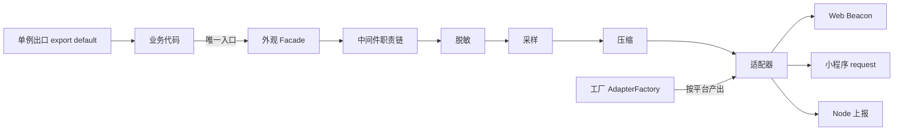

## DP-146：通用 SDK 的模式组合怎么设计？各模式承担什么？（外观+工厂+职责链+单例 压轴）
**答**：
- 五件套分工：外观（统一入口 `track/user/destroy`）、工厂（按环境/平台产出适配器）、职责链（中间件处理上报数据：脱敏→采样→压缩）、单例（模块级唯一实例）、观察者（自动订阅全局事件）。
- 设计顺序：先定外观 API（用户视角）→ 再用工厂适配环境差异 → 中间件链处理横切逻辑 → 最后单例化出口。
- 与 DP-100 的差别：DP-100 侧重全景收束，本题给可背的五件套代码骨架，面试 15 分钟可手写。

```javascript
// 1 外观：业务唯一入口
class SDK {
  #adapters = new Map(); #middlewares = []; #adapter;
  constructor(options) {
    this.#adapter = AdapterFactory.create(options);          // 2 工厂：环境差异收口
  }
  use(mw) { this.#middlewares.push(mw); return this; }       // 3 职责链：注册中间件
  track(event, props = {}) {
    let ctx = { event, props, ts: Date.now() };
    for (const mw of this.#middlewares) ctx = mw(ctx) ?? ctx;  // 链式加工，返回 null 表示丢弃
    if (ctx) this.#adapter.send(ctx);                        // 适配器只管发
  }
}
// 2 工厂：按平台产出适配器
class AdapterFactory {
  static create({ platform }) {
    const impls = { web: WebAdapter, mp: MiniProgramAdapter, node: NodeAdapter };
    const Cls = impls[platform ?? 'web'];
    if (!Cls) throw new Error('不支持的平台 ' + platform);
    return new Cls();
  }
}
class WebAdapter { send(ctx) { navigator.sendBeacon('/collect', JSON.stringify(ctx)); } }
class MiniProgramAdapter { send(ctx) { wx.request({ url: '/collect', data: ctx }); } }
// 3 职责链：横切逻辑各成一段中间件
const desensitize = (ctx) => ({ ...ctx, props: { ...ctx.props, phone: ctx.props.phone?.replace(/(\d{3})\d{4}(\d{4})/, '$1****$2') } });
const sample = (ctx) => (ctx.event === 'pv' && Math.random() > 0.1 ? null : ctx);  // pv 抽样 10%
const compress = (ctx) => ({ ...ctx, props: JSON.stringify(ctx.props) });
// 4 单例出口：默认导出唯一实例（也可暴露 create 供多实例场景）
const sdk = new SDK({ platform: 'web' }).use(desensitize).use(sample).use(compress);
export default sdk;
export { SDK };
sdk.track('pay', { phone: '13812345678', channel: 'wechat' });   // 脱敏→采样→压缩→发送
```

SDK 模式组合图：


