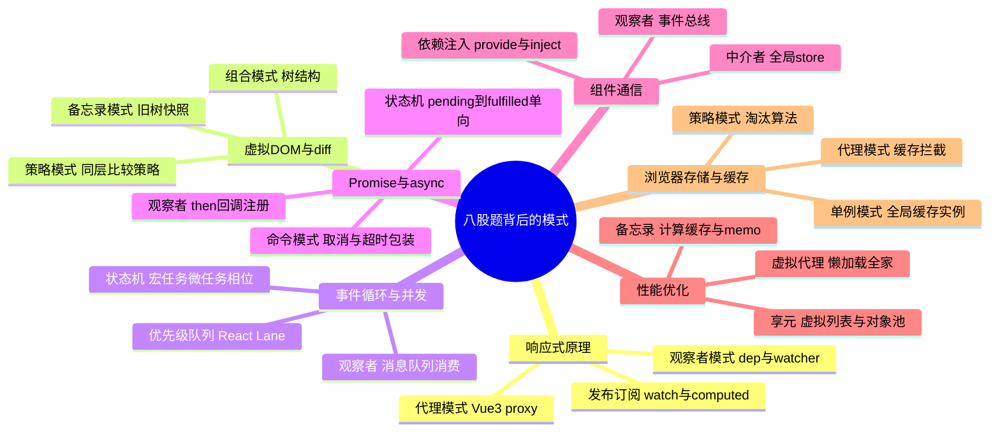

## DP-196：设计模式面试题 Top20 速答（一句话版本）。（高频）
**答**：
- 速答策略：先一句话点本质，再跟一个前端实例，10 秒内完成；下表按"模式 → 本质 → 前端实例"三列背。
- 用法：一面快问快答直接调用；二面追问时再展开对应 DP 编号的完整题。

```javascript
// Top20 速答表：pattern → 本质一句话 → 前端实例
const top20 = {
  单例: '全局唯一实例 + 受控访问点', instance: 'ESM 模块导出 / 全局 store',
  工厂: '把 new 的决定权交给工厂', instance: 'createElement / schema 表单控件',
  建造者: '链式收敛复杂配置，分步构建', instance: 'QueryBuilder / axios 默认配置',
  原型: '以既有对象为模板克隆创建', instance: 'Object.create / 组件默认配置合并',
  适配器: '转换接口形状使旧代码可用', instance: 'axios adapter / 后端 DTO 映射',
  装饰器: '不改原对象动态叠加职责', instance: 'HOC / @guard 错误包装',
  代理: '控制对目标对象的访问', instance: 'Vue3 reactive / 图片懒加载',
  外观: '给复杂子系统一个简单入口', instance: '统一埋点 SDK / $http',
  组合: '部分与整体同构统一处理', instance: '组件树 / 文件树渲染',
  享元: '共享细粒度对象省内存', instance: '虚拟列表 DOM 复用 / 对象池',
  观察者: '目标直接通知观察者', instance: 'dep 依赖收集 / watch',
  发布订阅: '经由中介 Topic 解耦收发', instance: 'EventBus / tapable',
  策略: '封装算法族，运行时替换', instance: '表单校验规则 / 促销计算',
  状态: '状态决定行为，转移受控', instance: '订单状态机 / xstate',
  命令: '操作对象化，可排队撤销', instance: '编辑器 undo / 操作日志',
  模板方法: '骨架固定，步骤可覆写', instance: '组件生命周期 / 导出流程',
  中介者: '多对多交互收敛为星型', instance: '表单联动中枢 / 微前端总线',
  职责链: '请求沿链传递，逐级处理', instance: 'axios 拦截器 / Koa 洋葱',
  迭代器: '统一遍历协议与实现解耦', instance: 'for-of / Generator',
  备忘录: '快照保存与恢复状态', instance: '撤销重做 / KeepAlive',
};
const quick = (name) => `${name}：${top20[name]}，例：${top20[top20[name] ? name : name] ?? ''}`;
quick('策略');   // 策略：封装算法族，运行时替换，例：表单校验规则 / 促销计算
```

再补一张"八股题背后的模式"映射 mindmap——答题时在原理后补一句"这背后是 X 模式"，能瞬间拔高一个档次；备考时按 mindmap 分支自查，每个八股至少能说出一个模式名 + 一句对应关系：


