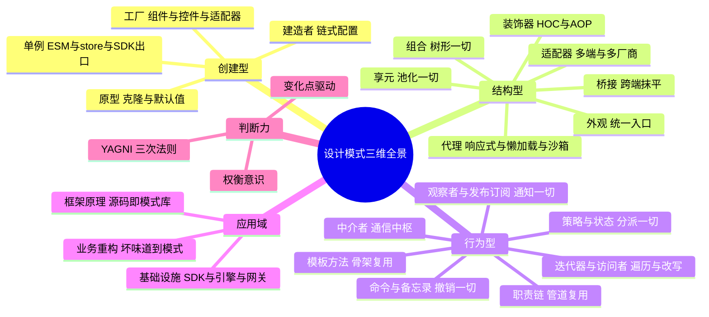

## DP-200：设计模式知识体系收束：三大类 × 框架/业务/基建的三维全景图。（高频压轴）
**答**：
- 收束方法：横轴 = 三大类（创建/结构/行为），纵轴 = 应用域（框架原理/业务重构/基础设施），每个交点背 1-2 个代表案例即可应对任何综合题。
- 答题策略升级：拿到设计题先报"变化点清单"，再为每个变化点匹配模式，最后主动说权衡——体现的是体系而不是名词。
- 本篇收束：DP-001~096 打单模式地基，DP-097~100 进框架源码，DP-101~200 完成业务实战与体系化，配合 mindmap 复习即可。

```javascript
// 三维全景速查表：行 = 三大类，列 = 应用域，格 = 代表案例
const panorama = {
  '创建型': {
    框架原理: 'createElement 工厂 / ESM 单例 / h 与 VNode',
    业务重构: '促销策略注册表 / 控件工厂 / 请求 Builder（DP-107）',
    基础设施: 'SDK 多端适配工厂（DP-146）/ 缓存实例工厂（DP-188）',
  },
  '结构型': {
    框架原理: 'Vue3 代理 / HOC 装饰器 / KeepAlive 享元',
    业务重构: '上帝对象拆分（DP-104）/ 多厂商适配器（DP-113）/ 图片池（DP-111）',
    基础设施: '统一 SDK 外观（DP-146）/ 数据源适配（DP-138）/ 权限组件库（DP-174）',
  },
  '行为型': {
    框架原理: '响应式观察者 / 拦截器职责链 / 模板编译访问者',
    业务重构: '促销引擎（DP-101）/ 订单状态机（DP-102）/ 表单联动（DP-145）',
    基础设施: '风控链（DP-112）/ 日志链（DP-150）/ 配置热更新观察者（DP-152）',
  },
};
// 万能答题模板（30 秒框架）：
// 1 需求转译：这题本质是"管理 N 个可变点"
// 2 变化点清单：渠道会加 → 策略；顺序有讲究 → 职责链；要可回退 → 命令+备忘录
// 3 组合方案：一句话架构 + 关键接口签名
// 4 权衡收尾：不引入 IoC 容器、不上微内核（YAGNI），理由是当前规模
const answerTemplate = (changePoints) => changePoints.map((c) => `${c} → ${modeFor(c)}`).join('；');
const modeFor = (point) => ({ 会增减类型: '策略+工厂', 顺序流程: '职责链/模板方法', 要撤销回滚: '命令+备忘录', 多方通信: '观察者/中介者', 性能瓶颈: '享元+代理', 接口不一致: '适配器+外观' }[point] ?? '先别抽');
```

全景收束 mindmap：



---

> **DP-001 ~ DP-200 全部完成**。DP-101 ~ DP-200：重构实战、模式组合、React/Vue 深化、数据层、UI 架构、基础设施、模式变体、反模式、综合与体系。
