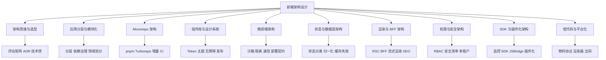

# 前端面试题库：前端架构设计

## 简介

本专题面向大厂高级/资深前端面试，聚焦**前端架构设计**：技术选型与架构决策、工程分层与模块化、Monorepo、组件库/设计系统、微前端、状态与数据层架构、渲染与 BFF、权限与安全、SDK 与插件化、低代码平台。考核重点不是"会用什么"，而是**讲清楚为什么这么设计、权衡是什么、演进路径是什么**。与 ENG（工程工具链）、OPS（运维上线）两个专题互补，不重复。

## 专题总览

## 目录

- 一、架构思维与选型（ARC-001 ~ ARC-008）
- 二、应用分层与模块化（ARC-009 ~ ARC-018）
- 三、Monorepo 架构（ARC-019 ~ ARC-027）
- 四、组件库与设计系统（ARC-028 ~ ARC-038）
- 五、微前端架构（ARC-039 ~ ARC-050）
- 六、状态与数据层架构（ARC-051 ~ ARC-059）
- 七、渲染与 BFF 架构（ARC-060 ~ ARC-067）
- 八、权限与安全架构（ARC-068 ~ ARC-074）
- 九、SDK 与插件化架构（ARC-075 ~ ARC-087）
- 十、低代码与平台化（ARC-088 ~ ARC-100）
- 十一、大型系统首屏与性能架构（ARC-101 ~ ARC-108）
- 十二、多端与跨端架构（ARC-109 ~ ARC-116）
- 十三、实时协作与编辑器架构（ARC-117 ~ ARC-122）
- 十四、质量与测试架构（ARC-123 ~ ARC-131）
- 十五、可观测性与 DevEx 架构（ARC-132 ~ ARC-138）
- 十六、渐进迁移架构（ARC-139 ~ ARC-146）
- 十七、AI 时代的架构演进（ARC-147 ~ ARC-152）
- 十八、数据与安全专项（ARC-153 ~ ARC-159）
- 十九、组织与协作架构（ARC-160 ~ ARC-166）
- 二十、综合案例与演进（ARC-167 ~ ARC-200）

---

## 一、架构思维与选型（ARC-001 ~ ARC-008）

