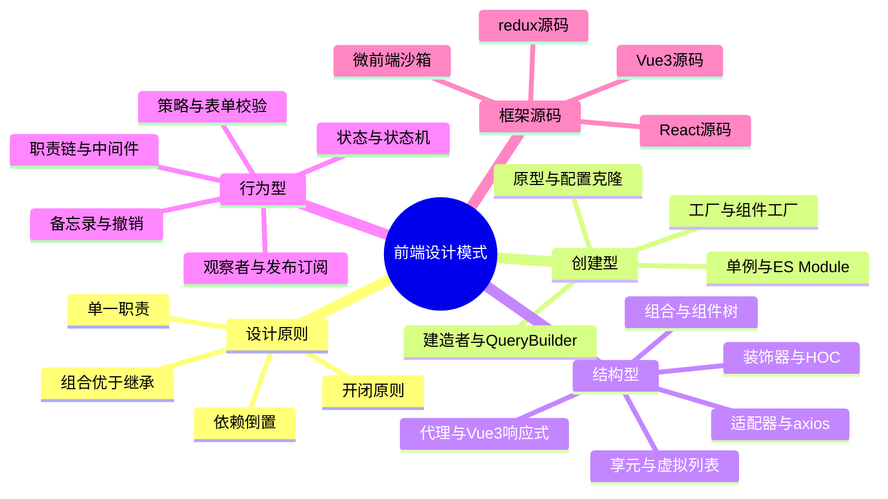

# 前端面试题库：前端设计模式

> **专题定位**：经典 GoF 设计模式在前端/框架源码/业务代码中的识别与应用。大厂高频考点：讲得出模式名、说得出框架对应物、写得出简化实现。
>
> **覆盖范围**：本文收录 DP-001 ~ DP-200。一至十一章为：设计原则总论、创建型（单例/工厂/建造者/原型）、结构型（适配器/装饰器/代理/外观/组合/享元/桥接）、行为型（观察者/策略/状态/命令/模板方法/中介者/职责链/迭代器/访问者/备忘录）、函数式模式变体、框架源码模式识别综合；十二至二十一章为：业务重构实战、模式组合实战、React/Vue 业务深化、数据层、UI 架构、基础设施、前端特有模式变体、反模式与陷阱、综合与体系。
>
> **备考建议**：每题先看"答"的要点框架，再对照代码块手写一遍。模式题考察"识别 + 实现 + 权衡"，源码题考察"指认 + 讲清动机"。

## 目录

- [一、设计原则与总论](#一设计原则与总论)：DP-001 ~ DP-007
- [二、单例模式](#二单例模式)：DP-008 ~ DP-013
- [三、工厂模式](#三工厂模式)：DP-014 ~ DP-019
- [四、建造者与原型](#四建造者与原型)：DP-020 ~ DP-024
- [五、结构型：适配器/装饰器/代理](#五结构型适配器装饰器代理)：DP-025 ~ DP-034
- [六、结构型：外观/组合/享元/桥接](#六结构型外观组合享元桥接)：DP-035 ~ DP-042
- [七、行为型：观察者与发布订阅](#七行为型观察者与发布订阅)：DP-043 ~ DP-050
- [八、行为型：策略/状态/命令](#八行为型策略状态命令)：DP-051 ~ DP-058
- [九、行为型：模板方法/中介者/职责链/迭代器/访问者](#九行为型模板方法中介者职责链迭代器访问者)：DP-059 ~ DP-068
- [十、函数式与前端的模式变体](#十函数式与前端的模式变体)：DP-069 ~ DP-085
- [十一、框架源码中的模式识别综合](#十一框架源码中的模式识别综合)：DP-086 ~ DP-100
- [十二、重构实战：从坏代码到模式](#十二重构实战从坏代码到模式)：DP-101 ~ DP-108
- [十三、模式组合实战](#十三模式组合实战)：DP-109 ~ DP-116
- [十四、React 业务模式深化](#十四react-业务模式深化)：DP-117 ~ DP-124
- [十五、Vue 业务模式深化](#十五vue-业务模式深化)：DP-125 ~ DP-131
- [十六、数据层模式](#十六数据层模式)：DP-132 ~ DP-138
- [十七、UI 架构模式](#十七ui-架构模式)：DP-139 ~ DP-145
- [十八、基础设施模式](#十八基础设施模式)：DP-146 ~ DP-152
- [十九、前端特有模式变体](#十九前端特有模式变体)：DP-153 ~ DP-159
- [二十、反模式与陷阱](#二十反模式与陷阱)：DP-160 ~ DP-166
- [二十一、综合与体系](#二十一综合与体系)：DP-167 ~ DP-200

---

## 一、设计原则与总论

