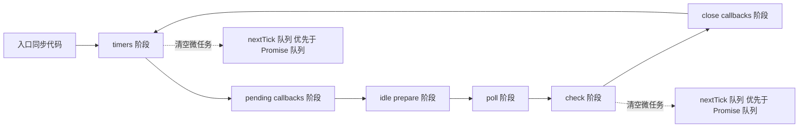

## NODE-001：Node 的事件循环有哪六个阶段？与浏览器的事件循环有什么区别？
**答**：
- 六阶段依次为：**timers**（执行 `setTimeout`/`setInterval` 到期回调）→ **pending callbacks**（执行上一轮延迟的 I/O 回调）→ **idle, prepare**（内部使用）→ **poll**（获取新 I/O 事件，执行 I/O 回调，必要时阻塞等待）→ **check**（执行 `setImmediate` 回调）→ **close callbacks**（执行 `close` 事件回调，如 `socket.on('close')`）。
- 每个阶段是一个 FIFO 回调队列；阶段间切换时，会**先清空 microtask 队列**（`process.nextTick` 优先级最高，其次 Promise）。
- 与浏览器的差异：浏览器没有多阶段模型（宏任务+微任务，且由渲染进程主导），Node 有阶段划分和 `process.nextTick` 这个独立队列；浏览器中 `setImmediate` 不存在，Node 中 `setTimeout(fn, 0)` 与 `setImmediate` 在主模块中顺序不确定，但在 I/O 回调中 `setImmediate` **总是先于** `setTimeout` 执行（因为 poll 阶段后进入 check 阶段）。
- 高频压轴：要求能画出六阶段图并解释 poll 阶段的阻塞与 `timers` 的系统调用差异（定时器精度受 OS 影响，不保证精确）。

```javascript
// 事件循环六阶段与经典顺序验证
const fs = require('fs');

setTimeout(() => console.log('1. timers 阶段'), 0);
setImmediate(() => console.log('2. check 阶段'));
fs.readFile(__filename, () => {
  // 在 I/O 回调（poll 阶段内）中，setImmediate 一定先于 setTimeout
  setImmediate(() => console.log('4. I/O 内 setImmediate 先执行'));
  setTimeout(() => console.log('5. I/O 内 setTimeout 后执行'), 0);
});
Promise.resolve().then(() => console.log('3. 微任务 在当前宏任务后立即清空'));
// 主模块中 1 和 2 的顺序理论上不确定（受进入事件循环的耗时影响），
// 但实际单次同步代码 <1ms 时 timers 通常先注册先执行。

console.log('0. 同步代码最先执行');
```


