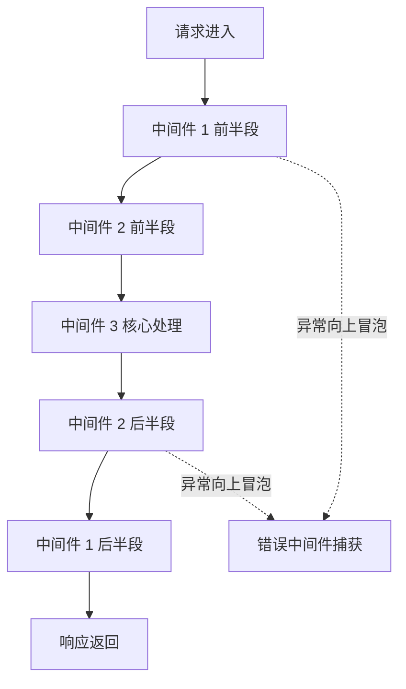

## NODE-023：手写 Koa 的 compose（洋葱模型核心）？
**答**：
- 洋葱模型 = 把所有中间件组成一个递归调用链：`dispatch(0)` 执行第 0 个，其内部 `await next()` 即 `dispatch(1)`……最后一层执行完后**逐层回溯**，前半段在请求前、后半段在响应前。
- 手写 compose 是高频压轴题（Koa 核心库 `koa-compose` 仅几十行）。三个硬性校验：中间件必须是函数、必须是顺序数组、`next` 不能被多次调用（同名 next 二次调用会困惑执行流）。
- 最后兜底一个 `noop` 中间件，保证最内层 `await next()` 不报错。

```javascript
// koa-compose 核心实现（手写版）
function compose(middleware) {
  if (!Array.isArray(middleware)) throw new TypeError('middleware 必须是数组');
  for (const fn of middleware) {
    if (typeof fn !== 'function') throw new TypeError('中间件必须是函数');
  }
  return function (context, next) {
    let index = -1;
    return dispatch(0);
    function dispatch(i) {
      if (i <= index) return Promise.reject(new Error('next() 被多次调用'));
      index = i;
      const fn = i === middleware.length ? next : middleware[i];
      if (!fn) return Promise.resolve();          // 兜底 noop
      try {
        return Promise.resolve(fn(context, dispatch.bind(null, i + 1)));
      } catch (err) {
        return Promise.reject(err);
      }
    }
  };
}

// 验证洋葱顺序
const app = {};
compose([
  async (ctx, next) => { console.log('1-进入'); await next(); console.log('1-退出'); },
  async (ctx, next) => { console.log('2-进入'); await next(); console.log('2-退出'); },
  async (ctx) => { console.log('3-核心处理'); ctx.body = 'done'; },
])({}).then(() => console.log('响应结束'));
// 输出：1-进入 → 2-进入 → 3-核心处理 → 2-退出 → 1-退出 → 响应结束
```


