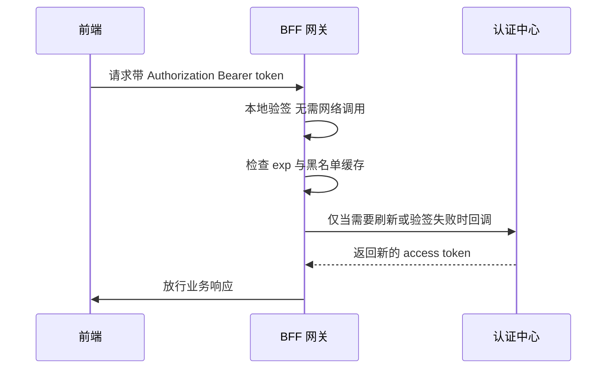

## NODE-034：JWT 的结构与签发/校验的完整实现？
**答**：
- JWT = `header.payload.signature`（Base64URL）：header 声明算法；payload 放 claims（`sub` 用户 id、`iat` 签发时间、`exp` 过期、`aud`/`iss` 受众与签发方）；signature = `HMAC(header.payload, secret)` 保证**防篡改**（不加密！payload 可被任何人解码，禁止放敏感信息）。
- 服务端校验：验签 → 验 `exp`/`iss`/`aud` → 验黑名单（见 NODE-035）。无状态是最大优点（无需查 Redis 即可确认身份），代价是**无法主动作废**。
- 高频追问：为什么不能把密码/手机号放 payload（Base64 可逆）；HS256 vs RS256（对称 vs 非对称，微服务间用 RS256 让网关验签而签发权集中在认证中心）。

```javascript
const crypto = require('node:crypto');

const SECRET = process.env.JWT_SECRET;
const base64url = (buf) => buf.toString('base64url');

function sign(payload, secret = SECRET, expiresInSec = 3600) {
  const header = base64url(Buffer.from(JSON.stringify({ alg: 'HS256', typ: 'JWT' })));
  const now = Math.floor(Date.now() / 1000);
  const claims = { ...payload, iat: now, exp: now + expiresInSec, iss: 'auth-center' };
  const body = base64url(Buffer.from(JSON.stringify(claims)));
  const signature = crypto.createHmac('sha256', secret).update(`${header}.${body}`).digest('base64url');
  return `${header}.${body}.${signature}`;
}

function verify(token, secret = SECRET) {
  const [header, body, signature] = token.split('.');
  // 1. 验签（时间安全比较防时序攻击）
  const expected = crypto.createHmac('sha256', secret).update(`${header}.${body}`).digest();
  const actual = Buffer.from(signature, 'base64url');
  if (actual.length !== expected.length || !crypto.timingSafeEqual(actual, expected)) {
    throw Object.assign(new Error('签名不合法'), { status: 401 });
  }
  const claims = JSON.parse(Buffer.from(body, 'base64url').toString());
  // 2. 验过期与签发方
  if (claims.exp * 1000 < Date.now()) throw Object.assign(new Error('token 已过期'), { status: 401 });
  if (claims.iss !== 'auth-center') throw Object.assign(new Error('签发方不合法'), { status: 401 });
  return claims;
}

// 生产可直接用 jsonwebtoken：
// jwt.sign({ uid: 42 }, SECRET, { expiresIn: '1h', issuer: 'auth-center' });
// jwt.verify(token, SECRET, { issuer: 'auth-center' });

const token = sign({ uid: 42, role: 'admin' }, SECRET, 60);
console.log(token);
console.log(verify(token));
console.log(token.split('.')[1]); // payload 可直接解码 → 别放敏感信息！
```


