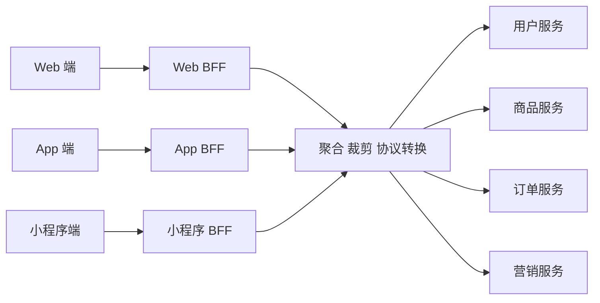

## NODE-046：BFF 是什么？它解决了什么问题？
**答**：
- BFF（Backend For Frontend）：**面向特定前端**的服务器中间层——为 Web/APP/小程序各自提供一个"懂这个端"的服务端，而不是让所有端共享一套通用 API。
- 解决的问题：① **多端适配**——同一个能力，PC 要全量字段、移动端要精简、小程序要聚合，后端不该为每个端改接口；② **聚合裁剪**——一个页面需要 3 个下游数据，BFF 一次聚合返回，减少前端串行请求与往返延迟；③ **协议转换**——下游是 gRPC/RPC/老 XML 接口，BFF 统一转成 HTTP/JSON；④ **防腐层**——下游接口变更、脏数据、拆分合并都被 BFF 消化，前端零感知。
- 本质权衡：多了一层部署与运维成本、多一跳延迟，换来前端的简单与后端的稳定。Node 是 BFF 的事实标准（JS 全栈、流处理强、I/O 密集友好）。



```javascript
// 没有 BFF：前端自己串行聚合 3 个接口，白屏时间长且逻辑散落各端
// const user  = await fetch('/api/user');        // 200ms
// const goods = await fetch('/api/goods');       // 300ms  → 前端串行 500ms+，
// const promo  = await fetch('/api/promo');      // 250ms     每个端都要重复这段胶水代码

// 有 BFF：一个页面级接口，服务端并行聚合，前端一次拿到可渲染数据
// GET /bff/page/home → { user: {...}, goods: [...], promo: {...} }  总耗时 ≈ max(200, 300, 250)
// 字段裁剪：移动端只回传 8 个字段而非下游的 40+ 个，省流量省解析
```
