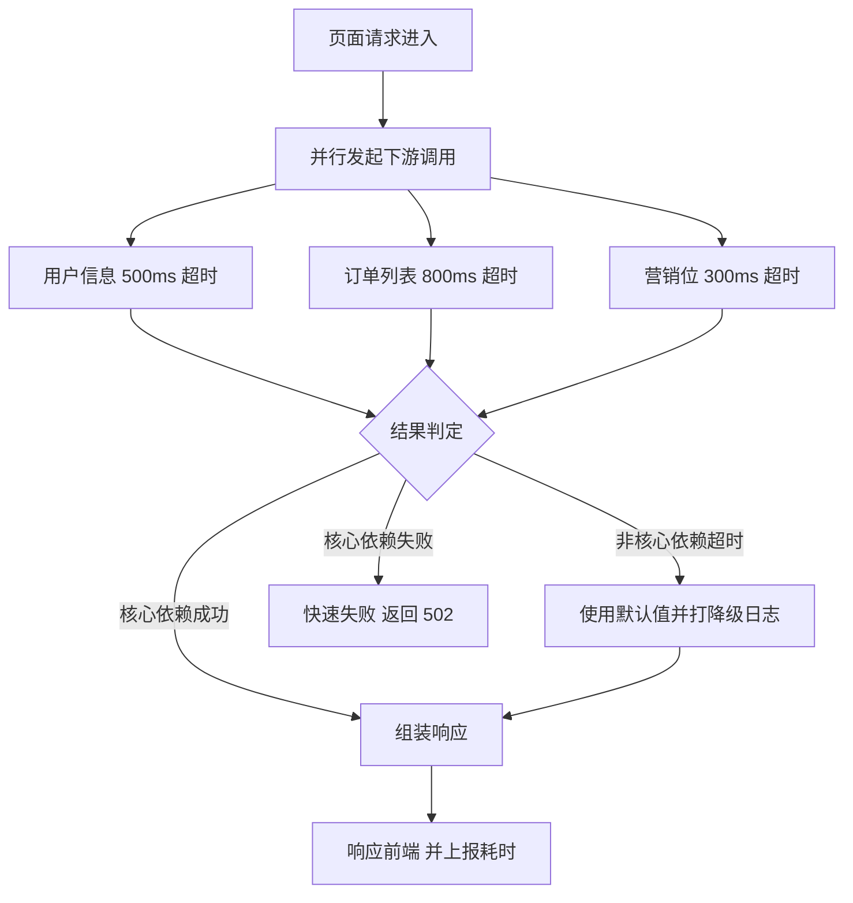

## NODE-048：如何设计接口聚合模式（并发聚合 + 超时降级）？
**答**：
- 核心要求：① 下游**并行**请求（Promise.all / allSettled）；② 每个依赖**独立超时**（AbortController），不让一个慢接口拖死整页；③ 分级降级——核心依赖失败快速报错，非核心依赖失败给默认值；④ 依赖图优化——先取主数据，再用其结果请求子依赖（避免 N+1）。
- 进阶：`Promise.all` 一损俱损 → 用 `allSettled` + 分级；同类依赖合并批量接口（`?ids=1,2,3`）替代循环单查；聚合结果做请求级缓存（同页面重复请求复用）。



```javascript
// 通用聚合器：超时 + 分级降级
async function gather(tasks) {
  // tasks: [{ name, required, timeout, loader, fallback }]
  const results = await Promise.all(tasks.map(async (t) => {
    const start = Date.now();
    try {
      const ctrl = new AbortController();
      const timer = setTimeout(() => ctrl.abort(), t.timeout);
      const data = await Promise.race([
        t.loader(ctrl.signal),
        new Promise((_, rej) => timer && setTimeout(() => rej(new Error('timeout')), t.timeout)),
      ]);
      clearTimeout(timer);
      return { name: t.name, ok: true, data, cost: Date.now() - start };
    } catch (err) {
      // 核心依赖失败：直接抛，快速失败；非核心：降级并记录
      if (t.required) throw Object.assign(err, { failedDeps: t.name });
      console.warn(JSON.stringify({ level: 'warn', event: 'bff_degrade', dep: t.name, msg: err.message }));
      return { name: t.name, ok: false, data: t.fallback, cost: Date.now() - start };
    }
  }));
  return Object.fromEntries(results.map((r) => [r.name, r.data]));
}

// 首页 BFF：核心 + 非核心依赖
router.get('/page/home', async (ctx) => {
  const uid = ctx.state.user?.uid ?? 0;
  const page = await gather([
    { name: 'user',    required: true,  timeout: 500,
      loader: (s) => fetchJSON(`${USER_API}/me?uid=${uid}`, 0, s).then((r) => r.json()) },
    { name: 'banners', required: true,  timeout: 800,
      loader: (s) => fetchJSON(`${CMS_API}/banners`, 0, s).then((r) => r.json()) },
    { name: 'reco',    required: false, timeout: 300, fallback: [],
      loader: (s) => fetchJSON(`${RECO_API}/feed?uid=${uid}`, 0, s).then((r) => r.json()) },
    { name: 'notice',  required: false, timeout: 200, fallback: { text: '' },
      loader: (s) => fetchJSON(`${CMS_API}/notice`, 0, s).then((r) => r.json()) },
  ]);
  ctx.set('server-timing', `total;dur=${Date.now() - ctx.state.start}`);
  ctx.body = page;
});
```
