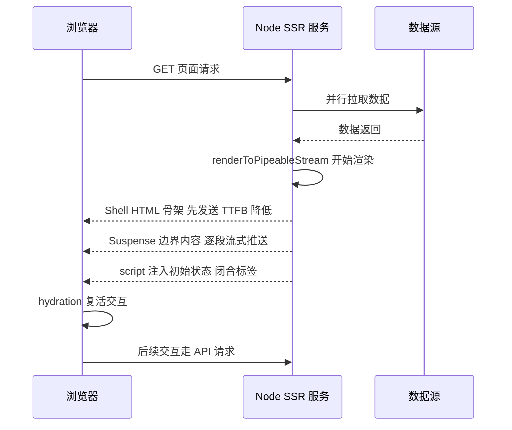

## NODE-053：Next.js 自定义服务器的 SSR 渲染流程是怎样的？renderToPipeableStream 在其中扮演什么角色？
**答**：
- React 18 服务端渲染核心 API：`renderToPipeableStream(reactNode, options)`——**流式输出** HTML 到 Node 可写流（`res`），不等整棵树完成才开始发送，TTFB 显著降低。
- 关键选项：`onShellReady`（骨架可发送，开始 pipe）、`onAllReady`（全部完成，适合爬虫/SEO 全量场景）、`onError`（错误记录并可回退客户端渲染）。
- 自定义服务器的职责：接管路由（app.render / renderToPipeableStream）、注入状态数据、设置缓存头、错误兜底为 CSR（`bootstrapScripts` 让客户端 hydrate）。

```javascript
const { renderToPipeableStream } = require('react-dom/server');
const express = require('express');
const app = express();

app.get('/', async (req, res) => {
  const [user, posts] = await Promise.all([
    getUser(req.cookies.sid),
    getPosts(),                              // 复用 BFF 的聚合与缓存
  ]);

  const stream = renderToPipeableStream(
    <App user={user} posts={posts} />,        // React 18 RSC 或 CSR 组件树
    {
      bootstrapScripts: ['/static/main.js'],  // 客户端 hydration 入口
      onShellReady() {                        // 骨架就绪：立即可流式发送
        res.statusCode = 200;
        res.setHeader('content-type', 'text/html; charset=utf-8');
        res.setHeader('cache-control', user ? 'private, max-age=0' : 'public, s-maxage=60');
        stream.pipe(res);                     // 持续把 HTML 片段推给浏览器
      },
      onAllReady() { /* 爬虫场景：等全部就绪再一次性发送 */ },
      onError(err) {
        console.error(JSON.stringify({ event: 'ssr_error', msg: err.message }));
        // 记录后可决定：部分降级（Suspense 边界）或整体回退 CSR
      },
    },
  );
});
app.listen(3000);
```


