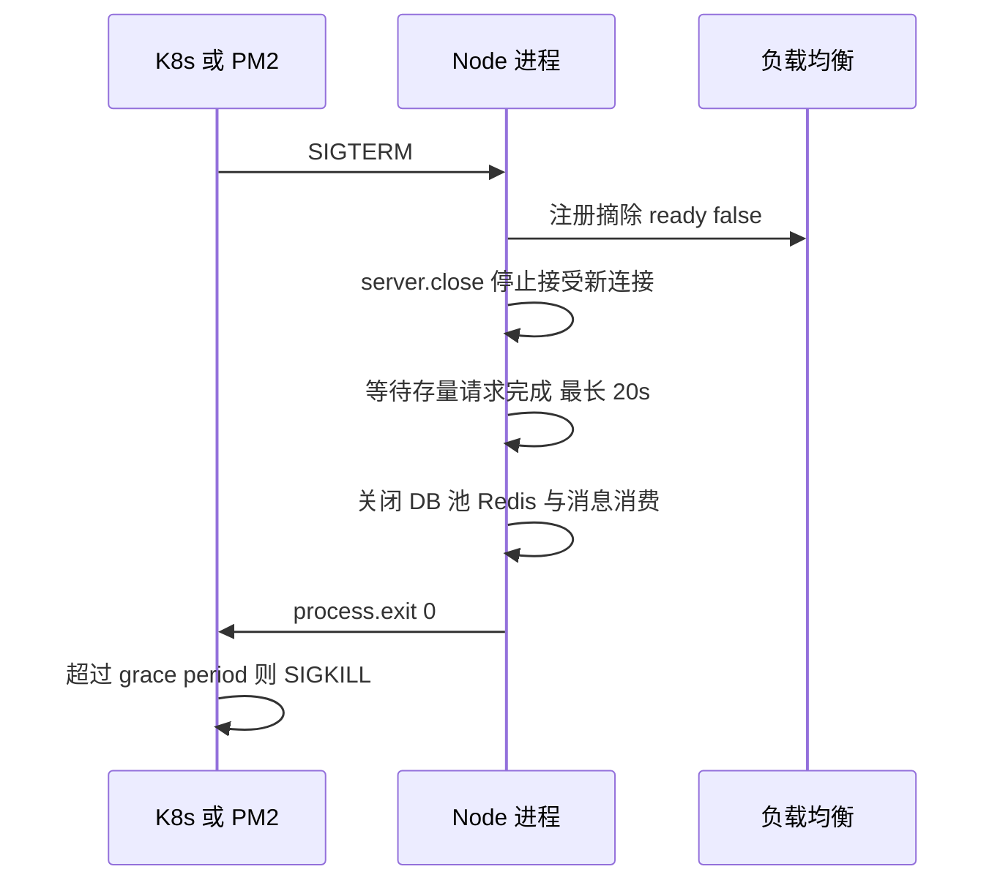

## NODE-060：如何实现优雅退出（SIGTERM 与连接排空）？
**答**：
- 流程：收到 SIGTERM → ① 停止接受新连接（`server.close()`）与摘除 LB 流量 → ② 等待存量请求处理完（设置强制超时）→ ③ 关闭资源（DB 池、Redis、消费队列）→ ④ `process.exit(0)`。
- 关键细节：K8s/PM2 发 SIGTERM 后最多等 `terminationGracePeriodSeconds`（如 30s）就 SIGKILL，所以处理逻辑必须在时限内完成；keep-alive 空闲连接要主动 `destroy`，否则 `server.close()` 会一直等；`uncaughtException` 退出前也要尽量走同一条排空路径。
- 高频坑：只 `process.exit()` 不排空 → 杀掉正在处理的请求，线上大量 502；PM2 `kill_timeout` 与 K8s `grace period` 要大于最长请求耗时。



```javascript
const http = require('node:http');

const server = http.createServer(handler);
server.keepAliveTimeout = 65000;

const state = { shuttingDown: false };

async function shutdown(signal) {
  if (state.shuttingDown) return;
  state.shuttingDown = true;
  console.log(`[${signal}] 开始优雅退出`);

  // 1. 健康检查返回失败 → LB/K8s 摘除流量
  app.set('ready', false);

  // 2. 停止接受新连接；正在处理的请求继续完成
  server.close(async () => console.log('全部连接已排空'));

  // 3. 主动断开 keep-alive 空闲连接（否则 close 会一直等待）
  server.getConnections((err, count) => {
    console.log(`剩余连接 ${count}`);
    server.emit('close');
  });

  // 4. 强制超时兜底：20s 内没排完也退出
  const forceTimer = setTimeout(() => {
    console.error('排空超时，强制退出');
    process.exit(1);
  }, 20000);
  forceTimer.unref();               // 不阻止进程自然退出

  // 5. 释放资源
  await Promise.allSettled([
    pool.end(),                     // MySQL 连接池
    redis.quit(),                   // Redis
    taskQueue.close(),              // 消息/任务队列
  ]);
  process.exit(0);
}

process.on('SIGTERM', () => shutdown('SIGTERM'));
process.on('SIGINT', () => shutdown('SIGINT'));

// 健康检查配合：就绪探针在排空期返回 503
app.get('/healthz/ready', (req, res) => {
  res.status(state.shuttingDown ? 503 : 200).json({ ready: !state.shuttingDown });
});
```
