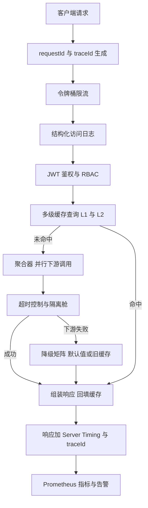

## NODE-068：设计一个完整的 BFF 层（鉴权、聚合、缓存、降级、限流全链路）？
**答**：
- 这是本专题的**压轴设计题**，考察把前面所有能力组装成体系：请求进入 → 限流 → 鉴权 → 聚合（超时/降级/隔离舱）→ 缓存 → 响应，全程 traceId 贯穿 + 结构化日志 + 指标埋点。
- 中间件顺序即架构：`requestId → 限流 → 日志 → 鉴权 → 路由（聚合）→ 错误兜底`。限流放最外（保护全服务），鉴权在聚合前（避免无登录态打下游）。
- 回答框架：先画分层图 → 每层一句话职责 → 关键设计决策（缓存键、降级矩阵、容量估算）→ 观测与预案。



```javascript
const Koa = require('koa');
const compose = require('koa-compose');
const app = new Koa();

// ===== 中间件编排：顺序即架构 =====
app.use(compose([
  trace(),            // 1. traceId
  rateLimit(),        // 2. 入口限流
  accessLog(),        // 3. 访问日志
  auth(),             // 4. JWT 鉴权
  cacheAndAggregate,  // 5. 核心业务
  errorHandler,       // 6. 错误兜底
]));

function trace() {
  return async (ctx, next) => {
    ctx.state.traceId = ctx.get('x-trace-id') || crypto.randomUUID();
    ctx.set('x-trace-id', ctx.state.traceId);
    ctx.state.start = Date.now();
    await next();
  };
}

function rateLimit() {
  const buckets = new Map(); // 生产替换 Redis 令牌桶，见 NODE-069
  return async (ctx, next) => {
    const b = buckets.get(ctx.ip) ?? { tokens: 50, last: Date.now() };
    const refill = ((Date.now() - b.last) / 1000) * 10; // 每秒 10 个
    b.tokens = Math.min(50, b.tokens + refill);
    b.last = Date.now();
    buckets.set(ctx.ip, b);
    if (b.tokens < 1) { ctx.status = 429; ctx.body = { code: 'RATE_LIMIT' }; return; }
    b.tokens -= 1;
    await next();
  };
}

function auth() {
  return async (ctx, next) => {
    if (PUBLIC_PATHS.has(ctx.path)) return next();   // 白名单：/healthz /login
    ctx.state.user = await verifyToken(ctx);          // NODE-034/035 的实现
    await next();
  };
}

// ===== 核心业务：聚合 + 多级缓存 + 降级矩阵 =====
async function cacheAndAggregate(ctx) {
  const match = ctx.path.match(/^\/page\/home$/);
  if (!match) { ctx.status = 404; return; }

  const cacheKey = `home:${ctx.state.user?.uid ?? 0}:${APP_VER}`;
  const cached = await getFromCache(cacheKey);        // L1 LRU + L2 Redis
  if (cached) { ctx.state.cache = 'HIT'; ctx.body = cached; return; }

  // 降级矩阵：每个依赖声明 required 与 fallback
  const page = await gather([
    { name: 'feed',    required: true,  timeout: 800, loader: () => call('feed-api', `/feed?uid=${ctx.state.user.uid}`), fallback: [] },
    { name: 'profile', required: false, timeout: 300, fallback: { nickname: '游客' }, loader: () => call('user-api', `/me`) },
    { name: 'ads',     required: false, timeout: 200, fallback: [], loader: () => call('ads-api', `/banners`) },
  ]);
  await setCache(cacheKey, page, 60);
  ctx.state.cache = 'MISS';
  ctx.body = page;
}

async function errorHandler(ctx, next) {
  try { await next(); }
  catch (err) {
    ctx.status = err.status || 500;
    ctx.body = { code: err.code || 'INTERNAL', traceId: ctx.state.traceId,
                 message: err.status ? err.message : '服务繁忙' };
    ctx.app.emit('error', err, ctx);
  } finally {
    ctx.set('server-timing', `total;dur=${Date.now() - ctx.state.start};cache=${ctx.state.cache ?? '-'}`);
    log.info({ event: 'access', traceId: ctx.state.traceId, status: ctx.status,
               cost: Date.now() - ctx.state.start, url: ctx.url });
  }
}

app.listen(3000);
// 附加设计要点：容量 = 峰值QPS / 单实例压测值 × 安全系数；预案 = 降级开关 + 缓存预热 + 弹性扩容
```
