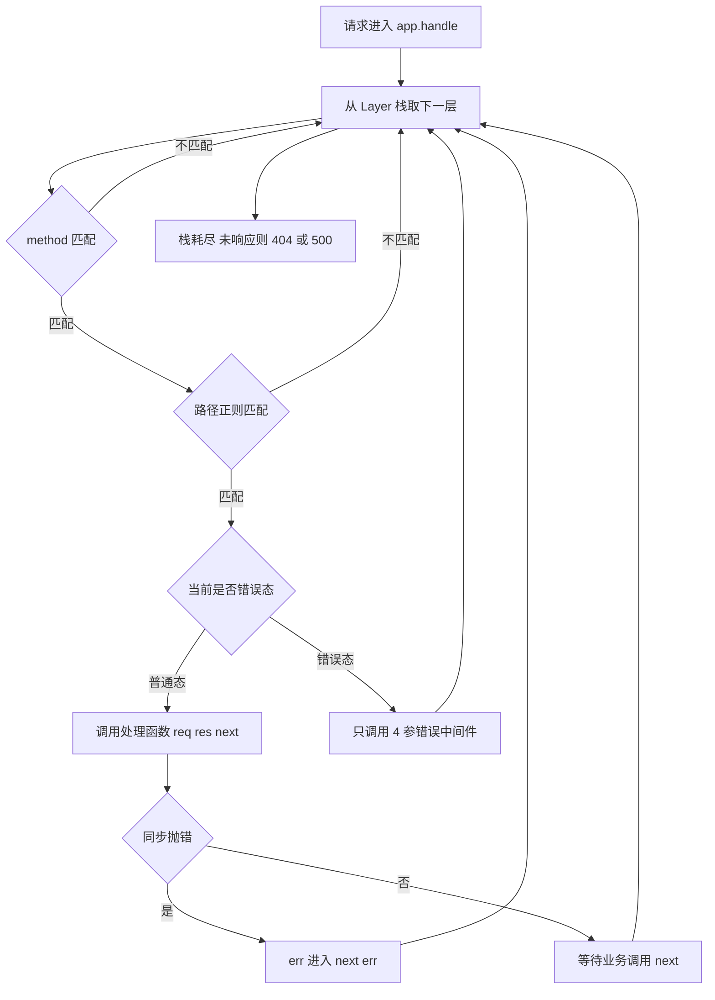

## NODE-108：手写 Express 核心——路由、中间件链与错误处理？
**答**：
- 核心 = **Layer 数组**：每层存 method/路径正则/处理函数；`app.use` 不限方法，`app.get/post` 限定方法。
- `next()` 驱动链式派发：不匹配继续找，匹配就调用并挂起等待下一次 `next`。
- 错误态规则：`next(err)` 或同步抛错后，**只派发给 4 参错误中间件**（`err, req, res, next`），普通中间件被跳过——这就是 Express 错误冒泡的全部秘密。
- 路径匹配：`:id` 编译为正则命名分组挂到 `req.params`；栈耗尽未响应则兜底 404/500。
- 与 Koa 的本质区别：Express 基于回调 `next`，错误必须显式传递；Koa 基于 Promise 天然冒泡。



```javascript
const http = require('http');

function createApp() {
  const stack = [];
  function add(method, path, fn) {
    const keys = [];
    const pattern = path.replace(/\/:([^/]+)/g, (_, k) => (keys.push(k), '/([^/]+)'));
    stack.push({ method, keys, fn, isErr: fn.length === 4, regexp: new RegExp(`^${pattern}/?$`) });
  }
  const app = (req, res) => {
    const pathname = req.url.split('?')[0];
    let i = 0;
    const next = (err) => {
      while (i < stack.length) {
        const layer = stack[i++];
        if (layer.method !== 'ALL' && layer.method !== req.method) continue;
        const m = pathname.match(layer.regexp);
        if (!m) continue;
        req.params = Object.fromEntries(layer.keys.map((k, j) => [k, m[j + 1]]));
        if (err && layer.fn.length !== 4) continue;   // 错误态只找 4 参错误中间件
        if (!err && layer.fn.length === 4) continue;  // 正常态跳过错误中间件
        try {
          err ? layer.fn(err, req, res, next) : layer.fn(req, res, next);
          return; // 挂起，等待业务回调 next 驱动后续
        } catch (e) { err = e; } // 同步异常转错误态继续冒泡
      }
      if (err) { res.statusCode = 500; res.end('Internal Error'); }
      else { res.statusCode = 404; res.end('Not Found'); }
    };
    next();
  };
  app.use = (fn) => add('ALL', '/', fn);
  app.get = (p, fn) => add('GET', p, fn);
  app.post = (p, fn) => add('POST', p, fn);
  app.listen = (...args) => http.createServer(app).listen(...args);
  return app;
}

// 使用：同步抛错自动被 4 参中间件接住
const app = createApp();
app.use((req, res, next) => { console.log('logger'); next(); });
app.get('/user/:id', (req, res) => {
  if (!/^\d+$/.test(req.params.id)) throw new Error('bad id'); // 同步异常 → 错误态
  res.end(`user ${req.params.id}`);
});
app.use((err, req, res, next) => { res.statusCode = 400; res.end(`err ${err.message}`); });
app.listen(3000);
```
