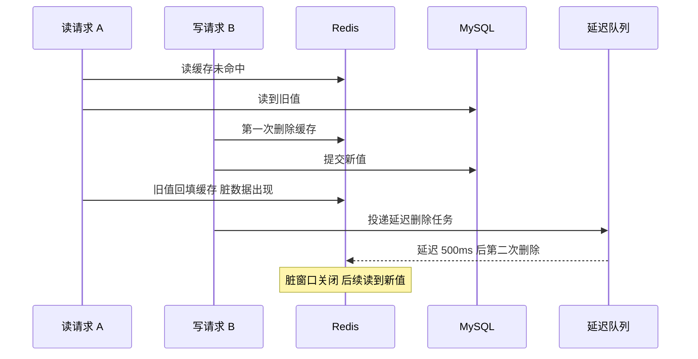

## NODE-145：缓存一致性怎么保（先更新 DB 再删缓存？延迟双删）？
**答**：
- 主流方案是 **Cache-Aside**：读→miss 回填；写→**先更新 DB 再删缓存**（不是更新缓存——并发写会互相覆盖旧值）。
- 为什么还要双删：并发下读请求可能在 DB 更新**前**读了旧值，又在更新**后**把旧值回填缓存——脏数据活到 TTL；第二次延迟删除专门清这种回填。
- 延迟量 ≈ 主从同步延迟 + 一次读耗时（几百 ms 量级）；生产用延迟队列/定时任务实现，不用 `setTimeout`（进程重启即丢）。
- 终极方案：Canal 订阅 binlog 异步删缓存——业务零侵入、顺序有保证；任何方案都要给缓存带 TTL 做最后防线。

```javascript
async function updateProduct(id, patch) {
  const key = `product:${id}`;
  await redis.del(key);                                     // 删①：立即删，缩短脏窗口
  await db.product.update({ where: { id }, data: patch });  // 写库
  await delayQueue.push({ key, delayMs: 500 });             // 删②：延迟删，清并发旧读回填
}
```


