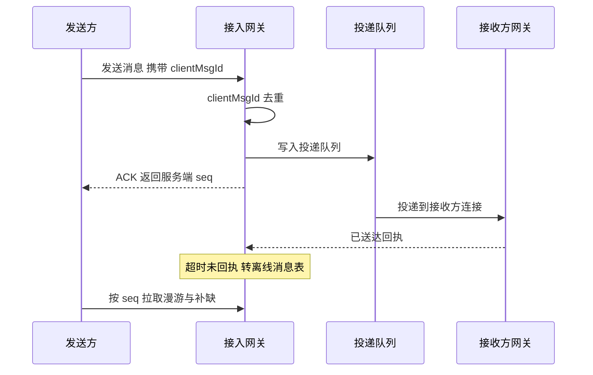

## NODE-162：设计一个 IM 消息服务（离线消息/已读/漫游）？
**答**：
- 可靠性三件套：**seq 序列号**（会话内单调递增，客户端按 seq 判缺）、**ACK 确认**（发送方 ACK 存 lastAckSeq）、**离线兜底**（投递超时未 ACK 落 offline 表，上线按 seq 补拉）。
- 消息去重：客户端生成 clientMsgId，服务端去重表拦截重发；服务端分配 seq 后才可投递。
- 漫游：消息按会话存 7 天 + 用户级同步 seq，换设备拉全量历史；已读回执只更新 lastReadSeq，不重发消息体。
- 架构：接入网关（WS 长连接，sticky，NODE-141）→ 投递队列 → 对端网关；跨机房按用户路由。



```javascript
io.on('connection', (socket) => {
  const uid = socket.handshake.auth.uid;
  online.set(uid, socket.id);

  socket.on('msg', async ({ clientMsgId, to, body }) => {
    if (await redis.set(`msg:dedup:${clientMsgId}`, 1, 'PX', 86400000, 'NX') === null) return; // 去重
    const convKey = [uid, to].sort().join(':');
    const seq = await redis.incr(`seq:${convKey}`);   // 会话内单调 seq
    const msg = { seq, from: uid, to, body, ts: Date.now() };
    await mq.publish('im.deliver', msg);              // 先落队列，进程崩溃不丢
    socket.emit('msg:ack', { clientMsgId, seq });     // 给发送方确认
  });

  socket.on('msg:ack', ({ seq }) =>                   // 已送达游标
    db.user.update({ where: { id: uid }, data: { lastAckSeq: seq } }));
  socket.on('msg:read', ({ convKey, seq }) =>         // 已读游标
    redis.hset(`read:${uid}`, convKey, seq));
});
// 上线补拉：max(lastAckSeq, lastReadSeq) 之后的 offline 表记录逐条补投
```
