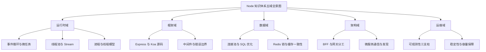

## NODE-188：Node 知识体系如何收束（五域全景图）？
**答**：
- 五域框架：**运行时**（事件循环/线程池/进程模型）、**框架**（Express/Koa 源码与中间件）、**数据**（连接池/SQL/Redis/缓存一致性）、**架构**（BFF/网关/微服务/通信）、**运维**（可观测/稳定性/容量/云原生）。
- 复习策略：每域抓"高频压轴"——运行时考事件循环输出题、框架考手写核心、数据考锁与一致性、架构考系统设计、运维考事故复盘。
- 与既有专题的关系：本文件覆盖服务端视角，前端基础（JS/浏览器/工程化）在 WEB/JS/ENG 等专题，两线交汇点正是 BFF 与 SSR。
- 面试表达框架：先说分层定位，再下钻某一域的源码级细节，最后用一次真实事故收尾（NODE-085/100）。

