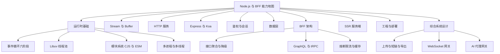

# 前端面试题库：Node.js 与 BFF

> 定位：前端工程师视角的服务端能力。覆盖 Node 运行时、Stream/Buffer、HTTP 服务、Express/Koa、鉴权会话、数据层、BFF 架构、SSR 服务端、工程化部署与综合系统设计。这是大厂高级前端（P6+/T3-2+）的必考域：会写页面是基本功，能独立负责一条服务端链路（BFF/SSR/网关）才是分水岭。
>
> 本文件收录 **NODE-001 ~ NODE-200**：NODE-001 ~ 100 为基础与实战主干，NODE-101 ~ 200 为源码级与体系化进阶。

## 知识总览

## 目录

- [一、Node 基础与运行时（NODE-001 ~ 008）](#一node-基础与运行时)
- [二、Stream 与 Buffer（NODE-009 ~ 014）](#二stream-与-buffer)
- [三、HTTP 服务（NODE-015 ~ 021）](#三http-服务)
- [四、Express 与 Koa（NODE-022 ~ 032）](#四express-与-koa)
- [五、鉴权与会话（NODE-033 ~ 038）](#五鉴权与会话)
- [六、数据层（NODE-039 ~ 045）](#六数据层)
- [七、BFF 架构（NODE-046 ~ 052）](#七bff-架构)
- [八、SSR 服务端（NODE-053 ~ 058）](#八ssr-服务端)
- [九、工程与部署（NODE-059 ~ 067）](#九工程与部署)
- [十、综合实战（NODE-068 ~ 100）](#十综合实战)
- [十一、事件循环与异步源码级（NODE-101 ~ 107）](#十一事件循环与异步源码级)
- [十二、框架源码级（NODE-108 ~ 114）](#十二框架源码级)
- [十三、网络与协议深入（NODE-115 ~ 120）](#十三网络与协议深入)
- [十四、数据库与存储深入（NODE-121 ~ 126）](#十四数据库与存储深入)
- [十五、安全深入（NODE-127 ~ 132）](#十五安全深入)
- [十六、可观测性深入（NODE-133 ~ 139）](#十六可观测性深入)
- [十七、高并发与稳定性（NODE-140 ~ 146）](#十七高并发与稳定性)
- [十八、微服务与协作（NODE-147 ~ 152）](#十八微服务与协作)
- [十九、TypeScript Node 工程（NODE-153 ~ 158）](#十九typescript-node-工程)
- [二十、综合与体系（NODE-159 ~ 200）](#二十综合与体系)

---

## 一、Node 基础与运行时

