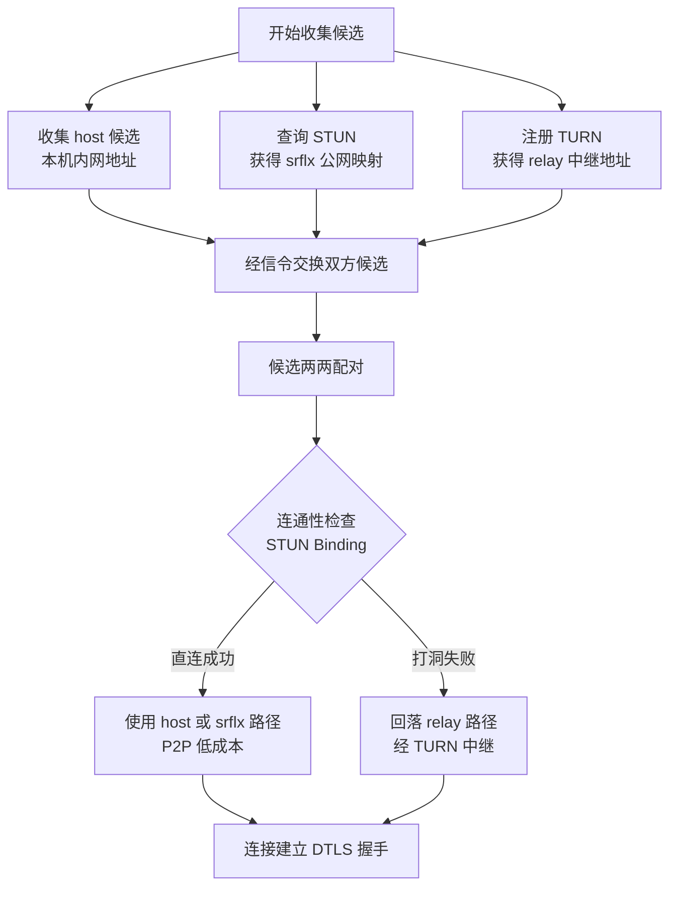

## AV-027：ICE/STUN/TURN 分别解决什么问题？打洞流程是怎样的？（高频压轴）
**答**：
- ICE 是框架：收集所有可用"候选地址"并两两配对连通性检查；STUN 服务器帮 NAT 内主机发现自己的公网映射地址；TURN 服务器在打洞失败时中继转发。
- NAT 类型影响成功率：全锥形/受限锥形易打洞成功，对称型 NAT 大概率要 TURN（约 10~20% 连接走中继）。
- 流程：收集候选 → 交换候选（经信令）→ STUN 连通性检查（配对）→ 选最优路径；全程可能几秒。
- 成本与安全：TURN 有带宽成本（媒体全量中继），要加长期凭证（time-limited credentials）防盗用。
- 面试必背：iceServers 配置 stun: 免费、turn: 需账号；`iceTransportPolicy: 'relay'` 可强制走 TURN（排查用）。

```javascript
// 完整 iceServers 配置与候选收集
const pc = new RTCPeerConnection({
  iceServers: [
    { urls: 'stun:stun.l.google.com:19302' },
    {
      urls: ['turn:turn.example.com:3478?transport=udp', 'turn:turn.example.com:443?transport=tcp'],
      username: 'user',
      credential: 'pass',
      // 更安全的做法：服务端下发短时效 HMAC 凭证
      // username: `${expiry}:user`, credential: hmacSha1(sharedSecret, username)
    },
  ],
  iceCandidatePoolSize: 4, // 预收集，加快后续建连
});

pc.addEventListener('icecandidate', (e) => {
  if (e.candidate) signaling.send({ type: 'candidate', candidate: e.candidate.toJSON() });
});
pc.addEventListener('iceconnectionstatechange', () => {
  console.log('ICE 状态:', pc.iceConnectionState); // checking → connected / failed / disconnected
  if (pc.iceConnectionState === 'failed') pc.restartIce(); // 自动重启 ICE
});
```


