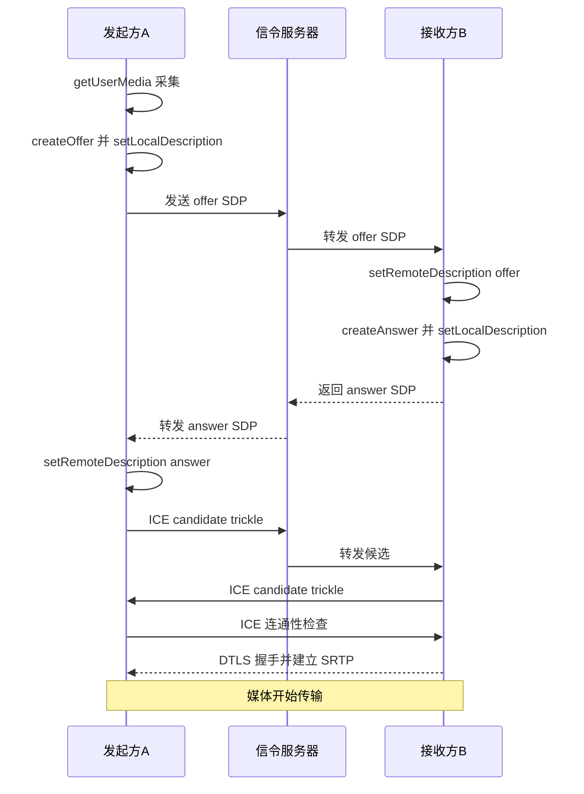

## AV-030：请完整描述 WebRTC 媒体协商的时序（含 ICE）。
**答**：
- 标准时序：A addTrack → createOffer → setLocalDescription(offer) → 信令发 offer → B setRemoteDescription(offer) → B addTrack → createAnswer → setLocalDescription(answer) → 回 answer → A setRemoteDescription(answer)。
- ICE 候选与 SDP 交换并行进行（trickle ICE）：收集到就发，不必等 SDP 完成。
- 全部完成后进入 DTLS 握手与媒体传输；`negotiationneeded` 事件是触发 offer 的官方信号。
- 易错点：answer 侧必须先 setRemoteDescription(offer) 再 createAnswer；双端同时 offer 会 glare，需要角色仲裁。



```javascript
// 发起方与应答方完整代码（与上图一一对应）
async function caller(pc, sig) {
  pc.onnegotiationneeded = async () => {
    const offer = await pc.createOffer();
    await pc.setLocalDescription(offer);
    sig.send({ type: 'offer', sdp: pc.localDescription });
  };
  sig.on('answer', (m) => pc.setRemoteDescription(m.sdp));
  sig.on('candidate', (m) => pc.addIceCandidate(m.candidate));
}
async function callee(pc, sig) {
  sig.on('offer', async (m) => {
    await pc.setRemoteDescription(m.sdp);
    const answer = await pc.createAnswer();
    await pc.setLocalDescription(answer);
    sig.send({ type: 'answer', sdp: pc.localDescription });
  });
  sig.on('candidate', (m) => pc.addIceCandidate(m.candidate));
}
```
