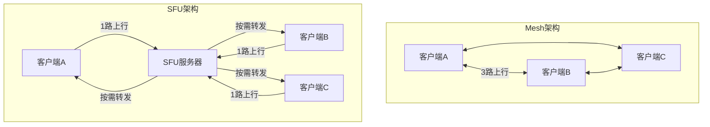

## AV-033：P2P、Mesh、SFU 三种架构怎么选？（高频压轴）
**答**：
- Mesh（全量 P2P）：每人上行 N-1 路，N 人会议上行带宽 O(N)，只适合 2~4 人小会；无服务器媒体成本。
- SFU（Selective Forwarding Unit）：每人只上行 1 路，SFU 按订阅转发给其他人；服务器带宽 O(N)，是 6~50 人会议主流。
- MCU：服务端解码再混流转码成一路，客户端最省但成本高、延迟高，现多用于录制/混流出 CDN。
- SFU 配套技术：simulcast（客户端同时发多档清晰度，SFU 按订阅者带宽选层）、SVC（时域/空域分层，VP9/AV1）、联级 SFU（跨机房扩展）。
- 选型口径：1v1 用 P2P（省成本），小型多人用 Mesh 可选、SFU 更稳，中大型必 SFU，万人直播 = SFU + 混流转 CDN。



```javascript
// simulcast：客户端同时上行 3 档，SFU 按订阅者带宽选层
const stream = await navigator.mediaDevices.getUserMedia({ video: true });
const [track] = stream.getVideoTracks();
pc.addTransceiver(track, {
  direction: 'sendonly',
  sendEncodings: [
    { rid: 'low',    maxBitrate: 150_000,   scaleResolutionDownBy: 4 },
    { rid: 'mid',    maxBitrate: 500_000,   scaleResolutionDownBy: 2 },
    { rid: 'high',   maxBitrate: 1_500_000, scaleResolutionDownBy: 1 },
  ],
});
// 接收端按需选择：只订阅 low 层（小窗）或 high 层（大屏）
const receiver = pc.getReceivers().find((r) => r.track.kind === 'video');
const params = receiver.getParameters();
params.encodings = [{ rid: 'high' }]; // 服务端 SFU 转发 high 层
// 浏览器端 layer 切换主要由 SFU 控制，此处示意消费端意图
```

---

## 五、实时互动场景（AV-034 ~ AV-040）
