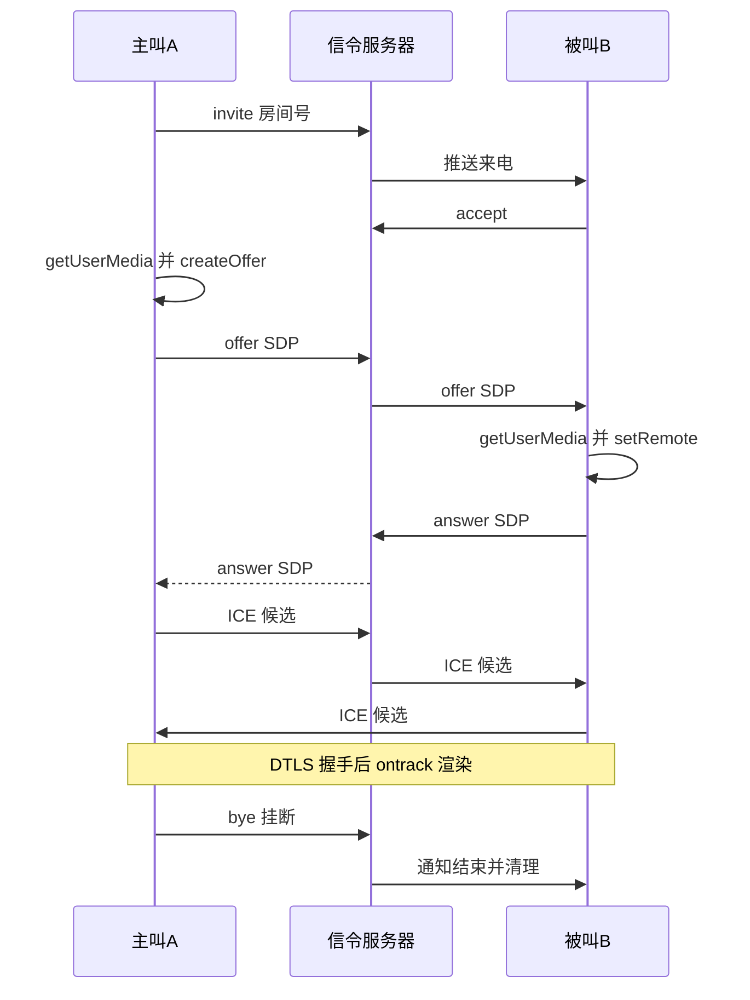

## AV-034：请设计一个 1v1 视频通话的完整实现（信令+协商+渲染）。（高频压轴）
**答**：
- 流程：A 采集 → 创建 PC 并 addTrack → offer → 信令 → B 采集并 answer → 双方交换 ICE → ontrack 渲染远端画面。
- 状态管理：idle/calling/ringing/connected/ended，UI 按状态渲染（呼叫中转圈、接听按钮、挂断）。
- 挂断要双向清理：关 track（stop 释放摄像头灯）、close PC、信令广播 leave，对端收到后同样清理并回到 idle。
- 远端流渲染注意 `ontrack` 可能多次触发（音频/视频各一次），用 `e.streams[0]` 挂 srcObject。
- 加分项：呼叫超时未接自动 cancel、reconnect 时 ICE restart、通话时长统计。



```javascript
// 1v1 通话核心类
class OneToOneCall {
  constructor(sig, localVideo, remoteVideo) {
    this.sig = sig; this.localVideo = localVideo; this.remoteVideo = remoteVideo;
    this.pc = new RTCPeerConnection({ iceServers: [{ urls: 'stun:stun.l.google.com:19302' }] });
    this.pc.ontrack = (e) => { this.remoteVideo.srcObject = e.streams[0]; };
    this.pc.onicecandidate = (e) =>
      e.candidate && this.sig.send({ type: 'candidate', candidate: e.candidate.toJSON() });
  }
  async start() {
    const stream = await navigator.mediaDevices.getUserMedia({ video: true, audio: true });
    this.localVideo.srcObject = stream;
    stream.getTracks().forEach((t) => this.pc.addTrack(t, stream));
    const offer = await this.pc.createOffer();
    await this.pc.setLocalDescription(offer);
    this.sig.send({ type: 'offer', sdp: this.pc.localDescription });
  }
  async accept(remoteOffer) {
    const stream = await navigator.mediaDevices.getUserMedia({ video: true, audio: true });
    this.localVideo.srcObject = stream;
    await this.pc.setRemoteDescription(remoteOffer);
    stream.getTracks().forEach((t) => this.pc.addTrack(t, stream));
    const answer = await this.pc.createAnswer();
    await this.pc.setLocalDescription(answer);
    this.sig.send({ type: 'answer', sdp: this.pc.localDescription });
  }
  hangup() {
    this.pc.getSenders().forEach((s) => s.track?.stop()); // 释放采集设备
    this.pc.close();
    this.sig.send({ type: 'bye' });
  }
}
```
