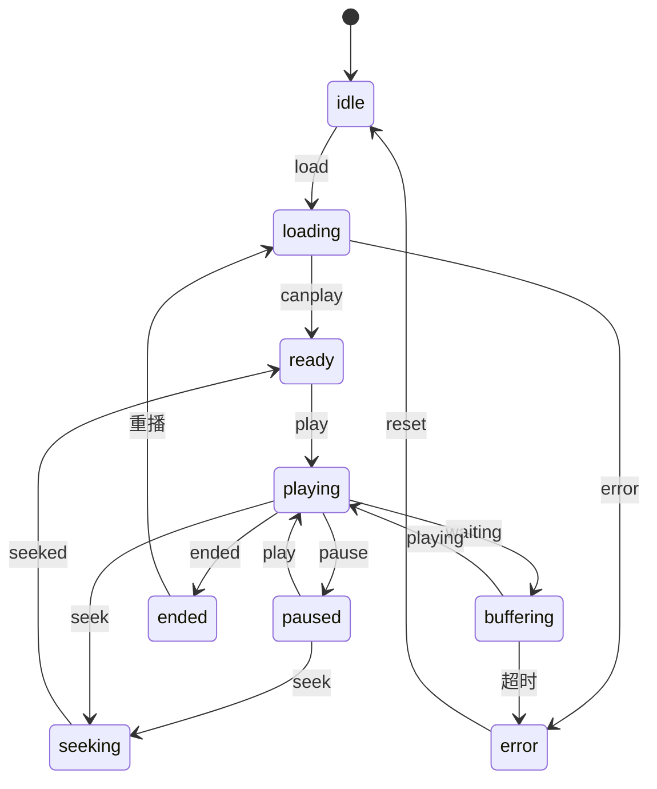

## AV-054：播放器状态机怎么设计？（loading/playing/paused/error）（高频压轴）
**答**：
- 显式状态机优于散落布尔值：定义有限状态（idle/loading/ready/playing/paused/buffering/seeking/ended/error）与合法迁移表。
- 映射规则：原生事件 → 状态。play 事件→playing、waiting→buffering、canplay→ready、seeking→seeking、error→error；`video.paused` 不可靠（buffering 时 paused 为 false），必须用 waiting/playing 对。
- UI 单向数据流：状态变更 emit 给所有订阅组件（控制条/加载动画/错误页），组件只渲染不决策。
- 非法迁移防御：如 error 状态下忽略 play 请求直到 reset；seeking 中忽略新的 seek（或排队最后一个）。
- 收益：埋点统计各状态停留时长（卡顿率=buffering 时长占比）、自动化测试状态覆盖。



```javascript
// 播放器状态机：迁移表 + 事件驱动
class PlayerStateMachine {
  static TRANSITIONS = {
    idle: ['loading'],
    loading: ['ready', 'error'],
    ready: ['playing', 'loading'],
    playing: ['paused', 'buffering', 'seeking', 'ended', 'error'],
    paused: ['playing', 'seeking', 'loading'],
    buffering: ['playing', 'error', 'loading'],
    seeking: ['ready', 'playing', 'buffering'],
    ended: ['loading', 'idle'],
    error: ['idle'],
  };
  constructor(video) {
    this.state = 'idle'; this.subs = new Set();
    const map = {
      loadstart: 'loading', canplay: 'ready', play: 'playing',
      pause: 'paused', waiting: 'buffering', playing: 'playing',
      seeking: 'seeking', seeked: 'ready', ended: 'ended', error: 'error',
    };
    for (const [evt, next] of Object.entries(map)) {
      video.addEventListener(evt, () => this.transition(next, evt));
    }
  }
  transition(next, evt) {
    const allowed = PlayerStateMachine.TRANSITIONS[this.state] ?? [];
    if (!allowed.includes(next)) return console.warn(`非法迁移 ${this.state}→${next}`, evt);
    const prev = this.state;
    this.state = next;
    this.subs.forEach((fn) => fn(next, prev, evt));
  }
  on(fn) { this.subs.add(fn); return () => this.subs.delete(fn); }
}
```
